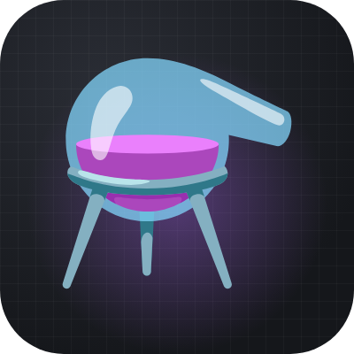
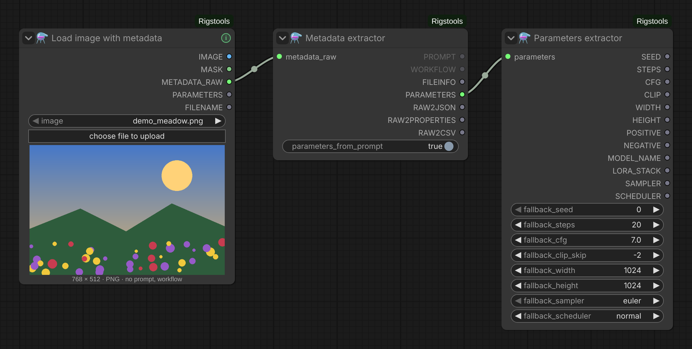
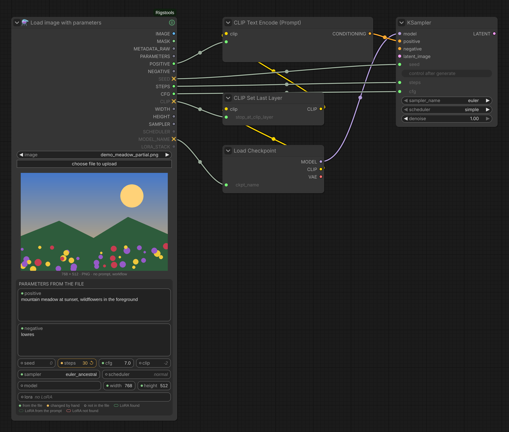
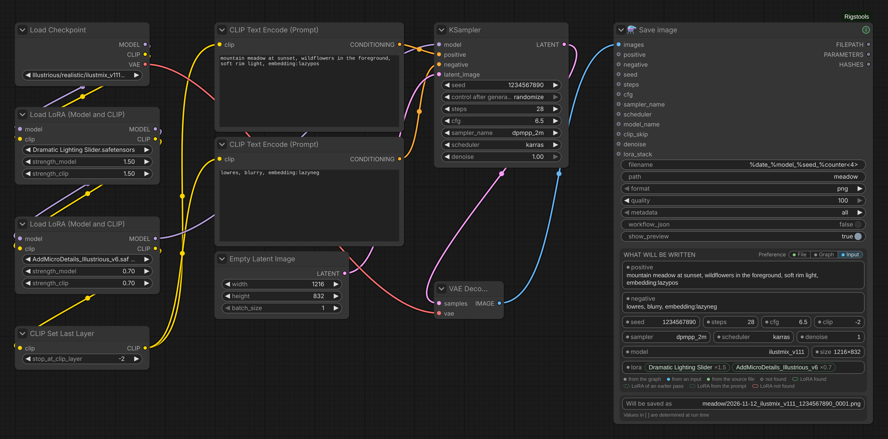
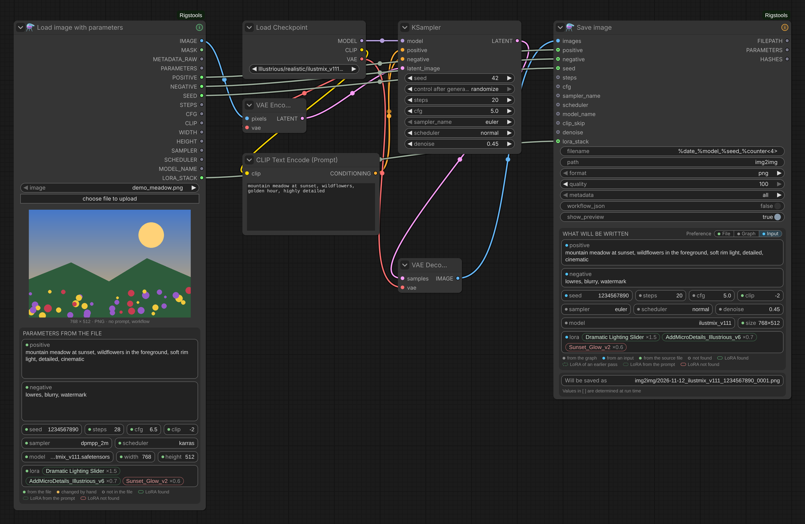

# ComfyUI-Rigstools

  

  
  

<b>English</b> · <a href="README.ru.md">Русский</a>

Load images with their generation data (PNG, JPEG, WebP) and read it back: the ComfyUI prompt and workflow, and the A1111-style parameters —
seed, steps, CFG, clip skip, size, prompts, model and LoRA stack — as separate outputs you can wire straight
into a new generation. A save node that collects the parameters from the graph by itself. Plus automatic colour correction without neural networks — white balance, levels,
vibrance, matching to a reference, with a histogram. Based on [ComfyUI-Crystools](https://github.com/crystian/ComfyUI-Crystools) by Crystian.

## Nodes

### Load image with metadata
Loads an image together with its generation data — a drop-in replacement for *Load image with metadata* of
Crystools: `METADATA_RAW` has the same format, so Metadata extractor and everything after it keep working.

- **Every format Image Saver writes.** PNG text chunks; for JPEG and WebP the EXIF: `UserComment` → parameters
  (Image Saver, A1111, Forge), `Make` / `Model` → workflow / prompt (Image Saver, stock *Save Animated WEBP*,
  old Crystools). Crystools reads only PNG fully.
  JPEG keeps at most 64 KB of EXIF, so Image Saver usually stores only the parameters there.
- **Input or output folder.** The list has the input files first, then the output files (newest first, marked
  `[output]`) — your own results load without copying them to input. The upload button puts a file into input.
- **What the file has, at a glance:**
  - the caption under the image continues the stock one: `1024 × 1536 · PNG · all metadata ✓`, otherwise it names
    what is missing (`parameters from prompt`, `no prompt, workflow`, `no metadata`);
  - outputs that carry nothing are dimmed; `PARAMETERS ↻` with an amber dot — rebuilt from the ComfyUI prompt;
    a **connected** output that carries nothing gets an amber ✕ instead of the dot, and its tooltip says why
    (not for `LORA_STACK`: "no LoRA" is a normal answer);
  - the **ⓘ** button in the title (green / amber / grey) opens the full parameters text with *Copy parameters*,
    *Copy prompt (JSON)* and *Open workflow* (opens in a new tab, like dropping the file on the canvas).
- Mask from the alpha channel (masks drawn in the mask editor are kept), EXIF rotation applied, the file is
  re-read when it changes.

| Output | Type | Content |
|---|---|---|
| `IMAGE`, `MASK` | IMAGE, MASK | the image and the mask from its alpha channel |
| `METADATA_RAW` | METADATA_RAW | all metadata — connect to **Metadata extractor** |
| `PARAMETERS` | STRING | A1111-style parameters (rebuilt from the prompt when the file has none) — can go straight to **Parameters extractor** |
| `FILENAME` | STRING | file name with the extension |

### Load image with parameters
The same loader, but the generation parameters are shown right under the picture, each in its own field —
and each is also an output. It replaces the *Load image with metadata → Metadata extractor → Parameters extractor*
chain with one node; the separate nodes stay, so existing workflows keep working and the nodes can be combined freely
(`METADATA_RAW` → Metadata extractor, `PARAMETERS` → Parameters extractor, `LORA_STACK` → LoRA hashes for Image Saver).

*The picture has no seed, clip skip or model: their fields have an empty circle, and the connected `SEED`, `CLIP` and
`MODEL_NAME` outputs show ✕ — a substitute comes out of them. `steps` was typed by hand: amber, ↺ returns the value of
the file.*

- Fields, in a card titled *Parameters from the file*: positive and negative prompt, `seed · steps · cfg · clip`,
  `sampler · scheduler`, `model · width · height`, LoRA. The dot before a label says where the value comes from:
  green — from the file, amber — changed by hand, an empty circle — not in the file; the legend is under the fields.
  Save image shows its values in the same card.
  They stretch with the node; on a narrow node the labels are shortened first (`sched…`), the full value is in the tooltip.
  Prompts and a long LoRA list scroll with the mouse wheel; past their end the wheel zooms the canvas as usual.
- **LoRA** — the models themselves, not the tag text: each LoRA of the image with its weight, found in `models/loras`
  (with the subfolder); a red one is not found there. Hover a LoRA to see its file. When the name in the image has no
  epoch and the file has one (`Style` → `Style-000003.safetensors`), the file is used if it is the only such epoch.
- **Fields can be edited.** A changed value is highlighted and goes to the output instead of the one from the image;
  ↺ returns the image value, Esc cancels typing. Typed values belong to the picture — choosing another picture clears them.
  They are saved with the workflow.
- Values the image doesn't have use the defaults (grey italics: seed 0, steps 20, cfg 7, clip −2, 1024 × 1024,
  euler / normal) and their outputs are dimmed. A model not found in `models/checkpoints` is red.
- The caption, dimmed outputs and the ⓘ button work as in Load image with metadata.

Outputs: `IMAGE`, `MASK`, `METADATA_RAW`, `PARAMETERS`, `POSITIVE`, `NEGATIVE`, `SEED`, `STEPS`, `CFG`, `CLIP`, `WIDTH`,
`HEIGHT`, `SAMPLER`, `SCHEDULER`, `MODEL_NAME`, `LORA_STACK`. `PARAMETERS` is the text from the file;
values typed in the panel are not written into it.

### Load image from folder
The same outputs plus `INDEX` and `COUNT`, but the file is picked from a folder:

- `folder`: `output`, `output/STEP_1`, `input/…`, `temp` or an absolute path (a plain relative path is inside output);
- `mode`: **by index** — file number `index` of the sorted list; with *control after generate* = `increment`
  each run takes the next file and wraps around at the end, so a queue of N runs processes the whole folder;
  **latest** — the newest file (generate → refine right away);
- `pattern`: name filter, several separated by `;` (`STEP_1_*.png; *.webp`), `sort`: name (natural, 2 before 10)
  or date modified, `subfolders`.

After a run the node shows the picture with the same caption, dimmed outputs and ⓘ button (with the file's number in the list).
In *latest* mode don't save into the same folder from the same workflow, or the next run picks up its own result.

### Metadata extractor
Splits the metadata of an image into separate outputs.

| Output | Type | Content |
|---|---|---|
| `PROMPT` | JSON | ComfyUI API prompt stored in the image |
| `WORKFLOW` | JSON | ComfyUI workflow stored in the image |
| `FILEINFO` | JSON | file name, resolution, date, size |
| `PARAMETERS` | STRING | A1111-style parameters text — connect it to **Parameters extractor** |
| `RAW2JSON` | JSON | all metadata as JSON |
| `RAW2PROPERTIES` | STRING | all metadata as `key=value` lines |
| `RAW2CSV` | STRING | all metadata as tab-separated key/value lines |

**Images without parameters** (e.g. saved by the stock *Save Image*): with `parameters_from_prompt` on (default),
the parameters are rebuilt from the ComfyUI prompt stored in the image. The main sampler is found in the graph
(a txt2img sampler from an empty latent is preferred over detailers and upscalers) and its seed, steps, CFG, sampler,
scheduler, size, prompts, checkpoint, LoRA (LoraLoader, LoRA Manager) and clip skip are traced back through the links —
including switches, string concatenation and Show Text nodes. Values that cannot be determined reliably
(random seeds, wildcards resolved at run time, unknown nodes) are left out, so Parameters extractor uses its fallbacks.
The rebuilt text ends with `Version: ComfyUI (rebuilt from prompt)`.

Input: `metadata_raw` (`METADATA_RAW`) from **Load image with metadata** — of Rigstools or of
[ComfyUI-Crystools](https://github.com/crystian/ComfyUI-Crystools).

### Parameters extractor
Parses the A1111-style parameters text into separate values.

| Output | Type | Content |
|---|---|---|
| `SEED` | INT | seed |
| `STEPS` | INT | sampling steps |
| `CFG` | FLOAT | CFG scale |
| `CLIP` | INT | clip skip as a negative number (e.g. `-2`), ready for *CLIP Set Last Layer* |
| `WIDTH`, `HEIGHT` | INT | image size |
| `POSITIVE`, `NEGATIVE` | STRING | prompts exactly as stored in the image (LoRA tags included — they are part of what the text encoder saw) |
| `MODEL_NAME` | STRING | checkpoint path in `models/checkpoints` when the file is found (subfolders, any case), otherwise the name from the image |
| `LORA_STACK` | STRING | `<lora:name:weight>` tags: the `Lora stack` field, otherwise the LoRA tags of the positive prompt; `None` when the image has no LoRA |
| `SAMPLER`, `SCHEDULER` | combo | ComfyUI names converted from A1111 / Civitai names (`DPM++ 2M Karras` → `dpmpp_2m` + `karras`) |

Input: `parameters` — the `PARAMETERS` output of Metadata extractor.

**Fallbacks.** `fallback_seed`, `fallback_steps`, `fallback_cfg`, `fallback_clip_skip`, `fallback_width`,
`fallback_height`, `fallback_sampler`, `fallback_scheduler`: a value found in the image wins, otherwise the fallback is used.
Set them on the node or convert them to inputs and connect your own values. Images without parameters
(e.g. saved by the stock Save Image) no longer stop the workflow — all values come from the fallbacks.

### LoRA hashes for Image Saver
Turns a LoRA stack (`<lora:name:weight> …`) into the `additional_hashes` string of
[Image Saver](https://github.com/alexopus/ComfyUI-Image-Saver), so LoRA get into the image metadata and are linked on
Civitai **without putting the LoRA tags into the prompt** — the tags change what the text encoder sees.

| Input / output | Content |
|---|---|
| `lora_stack` | LoRA tags, e.g. the `LORA_STACK` output of Parameters extractor |
| `with_weights` | write `Name:HASH:weight`; Image Saver accepts weights only with `download_civitai_data` on — turn off otherwise |
| `additional_hashes` (optional) | hashes to keep; put before the LoRA hashes |
| `ADDITIONAL_HASHES` | connect to `additional_hashes` of Image Saver |
| `NOT_FOUND` | LoRA from the stack that are not in `models/loras` |

Each LoRA is found in `models/loras` (same matching as Image Saver) and hashed with SHA-256 (first 10 characters).
Hashes are cached in `<lora>.sha256` next to the file — the same cache Image Saver uses, so a file is hashed once.

> The stock ComfyUI **Save Image** node does not write A1111-style parameters into PNG info.
> Save images with an A1111-compatible saver (e.g. the *Image Saver* custom nodes) to get them.

### Save image
Saves pictures with their generation data **without wiring the parameters by hand**: the node walks back from the
picture through the graph and finds the sampler, prompts, seed, steps, CFG, sampler / scheduler, checkpoint, LoRA from
the loader nodes (LoraLoader, Power Lora Loader, LoRA Manager), clip skip and the upscale / detailer passes. Values our
loaders read from a file (Parameters extractor, Load image with parameters) are taken from that file.

*txt2img: every value is found in the graph — the LoRA from the two loaders, clip skip from CLIP Set Last Layer, the
size from the empty latent.*

The panel on the node shows what **the next run will write**, in the same fields as Load image with parameters:
every value with a dot — grey from the graph, blue from a connected input, green from the source file, an empty circle
not found — and the name of the next file. In that name, values that are determined only at run time — the time, the
size after an upscale, a value of a connected input that a node computes — are shown in brackets: `[time]`, `[width]`,
`[height]`, `[seed]`. The node and the ⓘ window always show the next save, whether a run happened or not; what was
actually written goes to the console (Settings → Rigstools → Debug). ⓘ in the title opens the blocks written into the
file, the warnings and notes (a LoRA that is not in `models/loras`, a hash that will be calculated, a resource without a
Civitai ID) and the full parameters text. The node grows when its data does not fit and never shrinks by itself, so a
height set by hand stays. **🛟 Node Help** in the node's context menu lists the file name variables, the date codes and
examples.

#### Which pass gives the values
The node orders the samplers above the picture as they run and uses only the passes that redraw the whole picture —
samplers and upscalers (Ultimate SD Upscale and the like). Detailers and inpaint samplers (a sampler whose latent or
conditioning comes through an inpaint / *Set Latent Noise Mask* node) repaint only a part and are not used.
- **txt2img** — a pass starts from an empty latent: the main values come from the first such pass, the Hires fields
  (`Hires upscale`, `Hires steps`, `Hires upscaler`, denoise) from the last whole pass after it; the upscaler is the
  upscale model closest before that pass.
- **img2img** — no pass starts from an empty latent: the main values come from the last whole pass, as it made the
  picture; there are no Hires fields.

txt2img or img2img is decided by the kind of the latent node, not by its size.

#### Prompts and other values
- The prompt is followed from the text encoder of the main pass back through conditioning pass-through nodes,
  switches, pipes, Show Text and string concatenation nodes.
- **When it runs**, the node takes the values the nodes really output in this run from ComfyUI's execution cache —
  e.g. the text a concatenation produced, together with the trigger words LoRA Manager adds. Such a value is marked
  `[runtime]` in the console log. The cache is internal to ComfyUI; when a value is not there, the rules below apply.
- **Before the run** (and as the fallback): a concatenation keeps the parts that are known and leaves out the parts
  known only at run time; if no part is known, img2img takes the prompt of the source picture.
- **Size:** from the empty latent; in img2img, when the graph does not give it, the run writes the size of the picture
  being saved (not when there are Hires fields). Before the run it is shown as not found.
- A value read from the source file is marked "from the file" only when it reaches the node unchanged; text joined to
  it in the graph makes it "from the graph".

#### Preference: which source wins
The switch **Preference: File | Graph | Input** in the header of the card chooses the source that wins for every field;
the others are the fallback:

| Preference | Order |
|---|---|
| Input (default) | connected input → graph → source file |
| Graph | graph → connected input → source file |
| File | generation data of the source picture → connected input → graph |

A connected input counts even when its value is known only at run time. The size is never taken from the source file
(an upscaled picture has another size). The choice is saved with the workflow; workflows saved before it get *Input*,
the old behaviour.

*img2img: `positive`, `negative`, `seed` and `lora_stack` are wired from the loader (blue dots), steps, CFG, sampler
and denoise come from the KSampler of this pass. The red LoRA is not in `models/loras`, so ⓘ in the title is amber.*

#### LoRA
- **Input:** a connected `lora_stack` replaces the whole list. It takes a text of `<lora:name:weight>` tags separated by
  spaces, as the `LORA_STACK` output of our loaders gives it — not the `LORA_STACK` type of stacker nodes.
- **Graph:** the loaders on the model path of the main pass (LoraLoader, LoraLoaderModelOnly, Power Lora Loader,
  LoRA Manager — its active rows, in either form its list comes in), preceded by the LoRA of earlier passes: the
  `<lora:…>` tags in the prompt of the source picture, its `Lora stack`, then the tags in the current prompt. A LoRA met
  twice keeps the entry of this pass. The chips on the node show where each comes from: solid — this pass, dashed — an
  earlier pass, dotted — a tag in the prompt; red — not found in `models/loras`.
- **File:** only the LoRA of the source picture.

All of them go into `Lora hashes`, `Civitai resources` and `Lora stack`.

| Input / output | Content |
|---|---|
| `filename`, `path` | file name and subfolder of the output folder; variables `%date`, `%date<%Y%m%d>`, `%time`, `%model`, `%seed`, `%steps`, `%cfg`, `%sampler`, `%scheduler`, `%width`, `%height`, `%counter`, `%counter<4>` (next free number). An existing file is never overwritten |
| `format`, `quality` | png, jpeg (metadata up to 64 KB), webp (lossless at quality 100); quality is 100 by default |
| `metadata` | all — parameters + workflow; parameters only — for publishing without your workflow; none |
| `workflow_json` | also save the workflow next to the picture as `<name>.json` |
| `positive`, `negative`, `seed`, `steps`, `cfg`, `sampler_name`, `scheduler`, `model_name`, `clip_skip`, `denoise`, `lora_stack` (optional) | connect to give this value yourself — e.g. a prompt that a wildcard node builds at run time and the graph does not hold; with Preference = Input (default) it wins over the graph. `lora_stack`: `<lora:name:weight>` tags separated by spaces |
| `FILEPATH` | full paths of the saved files |
| `PARAMETERS` | the A1111-style parameters text that was written |
| `HASHES` | hashes of the model, LoRA and embeddings |

The parameters text has the A1111 fields A1111, Forge and Civitai read — including `Schedule type`, `Denoising strength`,
`Hires upscale` / `Hires steps` / `Hires upscaler`, `Lora hashes`, `TI hashes`, `Hashes` — plus `Lora stack`, so our
loaders give the LoRA with their weights back. Hashes use the `<file>.sha256` cache next to the model (the same one
Image Saver uses); a cache older than the file is recalculated.

**Civitai resources.** Civitai takes the LoRA weights only from the `Civitai resources` block, where each model is
given by its Civitai version id. The node writes it for every model, LoRA and embedding whose id it knows. Those go
only into this block (as in Image Saver), the others are found by their hashes; a LoRA without an id is linked on
Civitai too, just without its weight.

Where the data comes from:

| What | Source |
|---|---|
| hashes (SHA-256, the first 10 characters go into the file) | `<model>.sha256` next to the model — the same cache Image Saver uses; or the SHA-256 in LoRA Manager's `.metadata.json`; otherwise the node hashes the file once |
| Civitai version ids, in this order | 1. our cache `<ComfyUI user folder>/rigstools/civitai.json` (by the full SHA-256 — renaming or moving a model keeps it); 2. the files next to the model: `<model>.metadata.json` of LoRA Manager, `<model>.civitai.info` of Image Saver / Civitai Helper; 3. only with **Settings → Rigstools → Civitai → Look models up on Civitai by their hash** on (off by default): the public Civitai API by the hash, no API key |

Whatever 2 and 3 find is kept in our cache, so it works without LoRA Manager and Image Saver later too. "Not on
Civitai" is remembered and asked again after a week. LoRA Manager's files are found only when it keeps them next to
the models (its default); with its centralized storage they are not seen — turn the lookup on instead. The lookup
sends the hashes of your files to civitai.com, so Civitai learns which models you use. Nothing is written into the
model folders. When a big workflow does not fit into JPEG, the node
warns; turn on `workflow_json` to keep it in a file.

### Color correction
Automatic colour correction without neural networks — a replacement for the Auto mode of other colour nodes, with
every step visible and adjustable. Each picture of a batch is measured on its own.

| Input / output | Content |
|---|---|
| `strength` | overall strength: 0 — the original, 1 — the full correction |
| `white_balance` | removes a colour cast: near-neutral areas are moved towards grey, saturated colours keep their hue. An intended warm / cold mood is a cast too — keep it low for such pictures |
| `levels`, `levels_clip` | stretch the lightness between the darkest and the lightest tones (`levels_clip` % of pixels ignored at each end); hue and saturation stay |
| `vibrance`, `protect_skin` | raise the saturation of dull colours more than of saturated ones; skin hues are protected |
| `reference` (optional), `reference_strength` | match mean and spread of lightness and colour to a reference — e.g. the image before upscaling, when the upscale shifted the colours |
| `exposure`, `contrast`, `saturation`, `temperature`, `tint`, `lift`, `gamma`, `gain` | manual adjustments after the automatic steps (0 = off) |
| `mask` (optional) | correct only where the mask is white |
| `IMAGE` | the corrected image (an alpha channel is kept) |
| `HISTOGRAM` | RGB histograms of the result, the original as an outline — connect to Preview Image |

Order: reference → white balance → levels → vibrance → manual adjustments → mask → `strength`.

`reference_strength` is greyed out while no reference is connected. **🛟 Node Help** in the node's context menu explains
every setting.

## Output marks
All Rigstools nodes show what their outputs will carry:
- **dimmed** — nothing / only a substitute value (default, fallback, empty string);
- **↻ with an amber dot** — parameters rebuilt from the ComfyUI prompt;
- **amber ✕ instead of the dot** — the output is connected, but a substitute comes out of it (or, for
  `ADDITIONAL_HASHES`, some LoRA were not found and their hashes are missing).
  `LORA_STACK = None` and an empty `ADDITIONAL_HASHES` without LoRA get no ✕ — "no LoRA" is a normal answer.

Loaders know this from the file. Metadata extractor, Parameters extractor and LoRA hashes predict it before a run when
the chain starts at a Rigstools loader, otherwise they show it after a run (until an input is reconnected).

**Tooltips.** Output tooltips say what the output is and what its ✕ means. With
[Draftsman](https://github.com/ScrudgMcDack/ComfyUI-Draftsman) installed they become specific to the current picture:
a short title and a coloured line — green: what comes out ("From the parameters: 142778012163523"), amber: why a
substitute comes out ("No seed in the parameters — fallback_seed = 42 comes out"), grey: a note. Without Draftsman the
stock tooltip is shown (English).

## Installation
- **ComfyUI-Manager:** Custom Nodes Manager → search for “Rigstools” → Install.
- **comfy-cli:** `comfy node install comfyui-rigstools`
- **Manually:** `git clone https://github.com/ScrudgMcDack/ComfyUI-Rigstools` into `ComfyUI/custom_nodes/`.

Restart ComfyUI afterwards. No extra Python dependencies.

## Settings
In ComfyUI: **Settings → Rigstools → Civitai** (see Save image above) and **Settings → Rigstools → Debug** — details go
to the ComfyUI console: Save image, on each save, writes the files, the passes in the order they run, where the Hires
fields come from, every value with its source, the LoRA and the warnings; Load image with parameters, Parameters
extractor and Metadata extractor write what was read from the file (defaults and typed values marked, whether the model
was found); Color correction writes what the automatic steps measured and changed. Loading a picture into the panel,
step by step, goes to the browser console.

Environment variables: `RIGSTOOLS_LOGLEVEL` (Python logging level, default `20` = INFO) and `RIGSTOOLS_INDENT`
(JSON indent of the outputs, default `2`). The old `CRYSTOOLS_*` names still work.

## License
MIT — see [LICENSE](LICENSE). Based on ComfyUI-Crystools (MIT, © Crystian).
The icon is the Noto Emoji “alembic” (Apache 2.0), the Settings sidebar icon is Lucide “flask-conical” (ISC) — see
[THIRD_PARTY_NOTICES.md](THIRD_PARTY_NOTICES.md).
