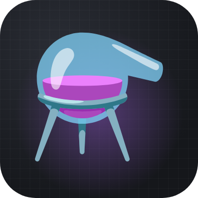
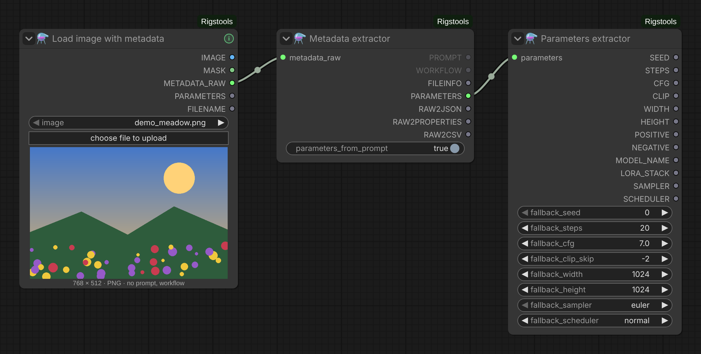
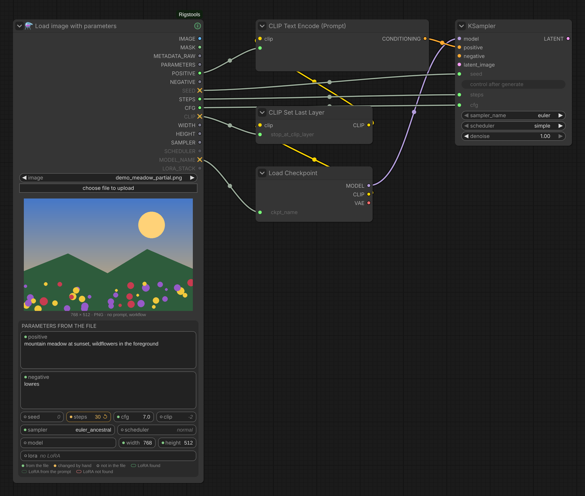
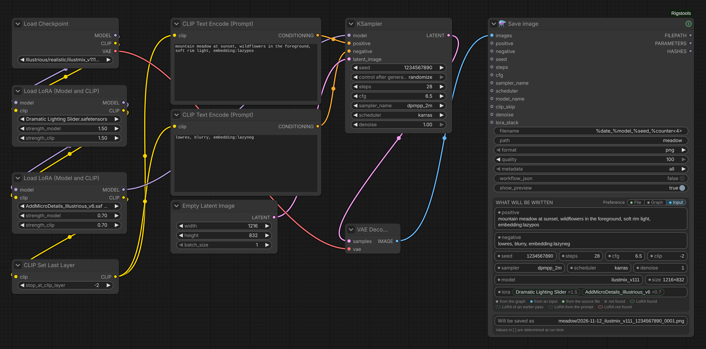
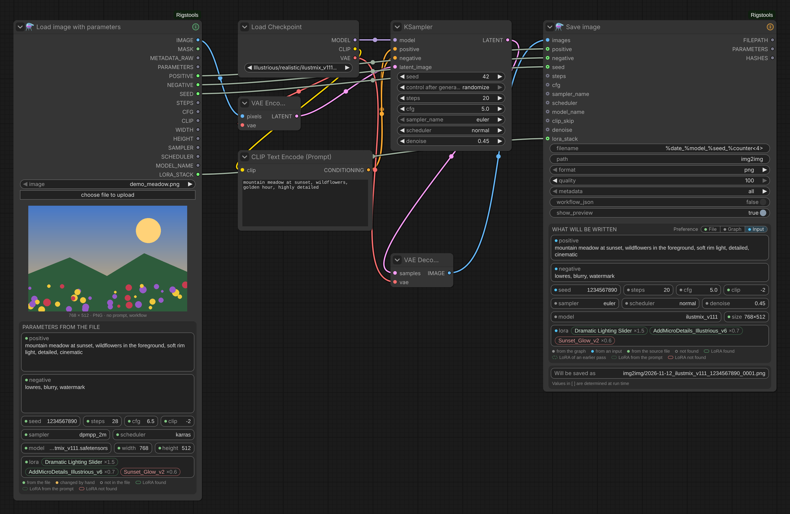

# ComfyUI-Rigstools

  

  
  

<a href="README.md">English</a> · <b>Русский</b>

Ноды для загрузки картинок с данными генерации (PNG, JPEG, WebP) и их чтения: промпт и workflow ComfyUI, а также параметры в формате A1111 —
seed, steps, CFG, clip skip, размер, промпты, модель и стек LoRA — отдельными выходами, которые можно сразу
подключить к новой генерации. Нода сохранения, которая сама собирает параметры из графа. А также автоматическая цветокоррекция без нейросетей — баланс белого, уровни,
вибранс, подгонка под образец, с гистограммой. Основано на [ComfyUI-Crystools](https://github.com/crystian/ComfyUI-Crystools) (автор — Crystian).

## Ноды

### Load image with metadata
Загружает картинку вместе с данными генерации — замена *Load image with metadata* из Crystools: у `METADATA_RAW`
тот же формат, поэтому Metadata extractor и всё, что после него, работает без изменений.

- **Все форматы, которые пишет Image Saver.** PNG — текстовые чанки; JPEG и WebP — EXIF: `UserComment` → parameters
  (Image Saver, A1111, Forge), `Make` / `Model` → workflow / prompt (Image Saver, стандартный *Save Animated WEBP*,
  старый Crystools). Crystools полностью читает только PNG.
  В JPEG помещается не больше 64 КБ EXIF, поэтому Image Saver обычно сохраняет туда только параметры.
- **Папка input или output.** В списке сначала файлы input, затем файлы output (новые сверху, с пометкой
  `[output]`) — свои результаты можно загружать без копирования в input. Кнопка загрузки кладёт файл в input.
- **Что есть в файле — видно сразу:**
  - подпись под картинкой продолжает стандартную: `1024 × 1536 · PNG · все метаданные ✓`, иначе в ней сказано,
    чего не хватает (`parameters из prompt`, `нет prompt, workflow`, `нет метаданных`);
  - выходы, по которым ничего не придёт, приглушены; `PARAMETERS ↻` с оранжевой точкой — восстановлено из промпта ComfyUI;
    у **подключённого** выхода, по которому ничего не придёт, вместо точки оранжевый ✕, а в подсказке — причина
    (кроме `LORA_STACK`: «нет LoRA» — нормальный ответ);
  - кнопка **ⓘ** в заголовке (зелёная / оранжевая / серая) открывает полный текст параметров с кнопками
    «Копировать parameters», «Копировать prompt (JSON)» и «Открыть workflow» (в новой вкладке, как при перетаскивании файла на холст).
- Маска из альфа-канала (маски из редактора масок сохраняются), поворот по EXIF, файл перечитывается при изменении.

| Выход | Тип | Что внутри |
|---|---|---|
| `IMAGE`, `MASK` | IMAGE, MASK | картинка и маска из её альфа-канала |
| `METADATA_RAW` | METADATA_RAW | все метаданные — подключается к **Metadata extractor** |
| `PARAMETERS` | STRING | параметры A1111 (восстановленные из промпта, если в файле их нет) — можно сразу в **Parameters extractor** |
| `FILENAME` | STRING | имя файла с расширением |

### Load image with parameters
Тот же загрузчик, но параметры генерации показаны прямо под картинкой, каждый в своём поле, — и каждый идёт на свой
выход. Одна нода вместо цепочки *Load image with metadata → Metadata extractor → Parameters extractor*; отдельные ноды
остаются, поэтому старые workflow работают, а ноды можно сочетать как угодно (`METADATA_RAW` → Metadata extractor,
`PARAMETERS` → Parameters extractor, `LORA_STACK` → LoRA hashes for Image Saver).

*В картинке нет seed, clip skip и модели: у их полей пустой кружок, а на подключённых выходах `SEED`, `CLIP` и
`MODEL_NAME` — ✕, на них идёт подстановка. `steps` введено вручную: оранжевое, ↺ возвращает значение из файла.*

- Поля, в карточке «Параметры из файла»: позитивный и негативный промпт, `seed · steps · cfg · clip`,
  `sampler · scheduler`, `model · width · height`, LoRA. Точка перед названием показывает, откуда значение:
  зелёная — из файла, янтарная — изменено вручную, пустой кружок — нет в файле; пояснение — под полями.
  Save image показывает свои значения в такой же карточке.
  Они растягиваются вместе с нодой; на узкой ноде сначала сокращаются названия (`sched…`), полное значение — в подсказке.
  Промпты и длинный список LoRA прокручиваются колёсиком мыши; когда прокручивать дальше некуда, колёсико масштабирует холст, как обычно.
- **LoRA** — сами модели, а не текст тегов: каждая LoRA картинки с весом, найденная в `models/loras` (с подпапкой);
  красная — не найдена. При наведении видно файл. Если в имени из картинки нет эпохи, а у файла есть
  (`Style` → `Style-000003.safetensors`), берётся этот файл — когда такая эпоха одна.
- **Поля можно править.** Изменённое значение подсвечивается и идёт на выход вместо значения из картинки; ↺ возвращает
  значение из картинки, Esc отменяет ввод. Введённые значения относятся к картинке — при выборе другой картинки они
  сбрасываются. Сохраняются вместе с workflow.
- Значения, которых нет в картинке, берутся по умолчанию (серым курсивом: seed 0, steps 20, cfg 7, clip −2,
  1024 × 1024, euler / normal), их выходы приглушены. Модель, не найденная
  в `models/checkpoints`, — красная.
- Подпись, приглушённые выходы и кнопка ⓘ — как у Load image with metadata.

Выходы: `IMAGE`, `MASK`, `METADATA_RAW`, `PARAMETERS`, `POSITIVE`, `NEGATIVE`, `SEED`, `STEPS`, `CFG`, `CLIP`, `WIDTH`,
`HEIGHT`, `SAMPLER`, `SCHEDULER`, `MODEL_NAME`, `LORA_STACK`. `PARAMETERS` — текст из файла;
значения, введённые в панели, в него не записываются.

### Load image from folder
Те же выходы плюс `INDEX` и `COUNT`, но файл выбирается из папки:

- `folder`: `output`, `output/STEP_1`, `input/…`, `temp` или абсолютный путь (просто относительный путь — внутри output);
- `mode`: **by index** — файл номер `index` в отсортированном списке; с *control after generate* = `increment`
  каждый запуск берёт следующий файл и после последнего начинает сначала, так что очередь из N запусков
  обработает всю папку; **latest** — самый новый файл (сгенерировал → сразу доработал);
- `pattern`: фильтр имён, несколько через `;` (`STEP_1_*.png; *.webp`), `sort`: по имени (естественный порядок,
  2 раньше 10) или по дате изменения, `subfolders` — с подпапками.

После запуска нода показывает картинку с той же подписью, приглушёнными выходами и кнопкой ⓘ (в окне — номер файла в списке).
В режиме *latest* не сохраняйте в ту же папку из того же workflow — иначе следующий запуск возьмёт собственный результат.

### Metadata extractor
Раскладывает метаданные картинки по отдельным выходам.

| Выход | Тип | Что внутри |
|---|---|---|
| `PROMPT` | JSON | промпт ComfyUI (API-формат), сохранённый в картинке |
| `WORKFLOW` | JSON | workflow ComfyUI, сохранённый в картинке |
| `FILEINFO` | JSON | имя файла, разрешение, дата, размер |
| `PARAMETERS` | STRING | текст параметров в формате A1111 — подключается к **Parameters extractor** |
| `RAW2JSON` | JSON | все метаданные в JSON |
| `RAW2PROPERTIES` | STRING | все метаданные строками `ключ=значение` |
| `RAW2CSV` | STRING | все метаданные строками «ключ — значение» через табуляцию |

**Картинки без parameters** (например, сохранённые стандартным *Save Image*): при включённом `parameters_from_prompt`
(по умолчанию) параметры восстанавливаются из промпта ComfyUI, сохранённого в картинке. В графе находится главный
сэмплер (txt2img-сэмплер с пустым латентом важнее детейлеров и апскейлеров), и по связям восстанавливаются seed, steps,
CFG, сэмплер, планировщик, размер, промпты, чекпойнт, LoRA (LoraLoader, LoRA Manager) и clip skip — в том числе через
переключатели, склейку строк и ноды Show Text. Значения, которые нельзя определить надёжно (случайный seed, wildcards,
раскрываемые при запуске, неизвестные ноды), пропускаются — для них Parameters extractor возьмёт запасные.
Восстановленный текст заканчивается на `Version: ComfyUI (rebuilt from prompt)`.

Вход: `metadata_raw` (`METADATA_RAW`) из **Load image with metadata** — Rigstools или
[ComfyUI-Crystools](https://github.com/crystian/ComfyUI-Crystools).

### Parameters extractor
Разбирает текст параметров A1111 на отдельные значения.

| Выход | Тип | Что внутри |
|---|---|---|
| `SEED` | INT | seed |
| `STEPS` | INT | число шагов |
| `CFG` | FLOAT | CFG scale |
| `CLIP` | INT | clip skip отрицательным числом (например, `-2`) — сразу для *CLIP Set Last Layer* |
| `WIDTH`, `HEIGHT` | INT | размер картинки |
| `POSITIVE`, `NEGATIVE` | STRING | промпты ровно в том виде, как записаны в картинке (с тегами LoRA — они тоже часть текста, который видел энкодер) |
| `MODEL_NAME` | STRING | путь к чекпойнту в `models/checkpoints`, если файл найден (с подпапками, без учёта регистра), иначе имя из картинки |
| `LORA_STACK` | STRING | теги `<lora:имя:вес>`: поле `Lora stack`, а если его нет — теги LoRA из позитивного промпта; `None`, если LoRA в картинке нет |
| `SAMPLER`, `SCHEDULER` | combo | имена ComfyUI, переведённые из имён A1111 / Civitai (`DPM++ 2M Karras` → `dpmpp_2m` + `karras`) |

Вход: `parameters` — выход `PARAMETERS` ноды Metadata extractor.

**Запасные значения.** `fallback_seed`, `fallback_steps`, `fallback_cfg`, `fallback_clip_skip`, `fallback_width`,
`fallback_height`, `fallback_sampler`, `fallback_scheduler`: если значение есть в картинке, берётся оно, иначе — запасное.
Их можно задать прямо на ноде или превратить во входы и подключить свои значения. Картинки без параметров
(например, сохранённые стандартным Save Image) больше не останавливают workflow — все значения берутся из запасных.

### LoRA hashes for Image Saver
Превращает стек LoRA (`<lora:имя:вес> …`) в строку для входа `additional_hashes` ноды
[Image Saver](https://github.com/alexopus/ComfyUI-Image-Saver). LoRA попадают в метаданные картинки и связываются с Civitai
**без тегов LoRA в промпте** — теги меняют текст, который видит энкодер, а значит и результат.

| Вход / выход | Что это |
|---|---|
| `lora_stack` | теги LoRA, например выход `LORA_STACK` ноды Parameters extractor |
| `with_weights` | писать `Имя:ХЭШ:вес`; Image Saver принимает веса, только если у него включён `download_civitai_data`, иначе выключите |
| `additional_hashes` (необязательный) | хэши, которые нужно сохранить; ставятся перед хэшами LoRA |
| `ADDITIONAL_HASHES` | подключается ко входу `additional_hashes` ноды Image Saver |
| `NOT_FOUND` | LoRA из стека, которых нет в `models/loras` |

Каждая LoRA ищется в `models/loras` (так же, как это делает Image Saver) и хэшируется SHA-256 (первые 10 символов).
Хэш кэшируется в файле `<lora>.sha256` рядом с LoRA — это тот же кэш, что у Image Saver, поэтому файл считается один раз.

> Стандартная нода ComfyUI **Save Image** не записывает параметры в формате A1111 в PNG.
> Чтобы они были, сохраняйте картинки A1111-совместимым сохранителем (например, нодами *Image Saver*).

### Save image
Сохраняет картинки с данными генерации **без ручного подключения параметров**: нода идёт по графу назад от картинки
и находит сэмплер, промпты, seed, steps, CFG, сэмплер и планировщик, чекпойнт, LoRA из нод-загрузчиков (LoraLoader,
Power Lora Loader, LoRA Manager), clip skip и проходы апскейла и детейлеров. Значения, которые наши загрузчики читают из
файла (Parameters extractor, Load image with parameters), берутся из этого файла.

*txt2img: все значения найдены в графе — LoRA из двух загрузчиков, clip skip из CLIP Set Last Layer, размер из пустого
латента.*

Панель на ноде показывает, что **запишет следующий запуск**, в тех же полях, что у Load image with parameters:
каждое значение с точкой — серой (из графа), синей (из подключённого входа), зелёной (из исходного файла) или пустым
кружком (не найдено), — и имя следующего файла. В этом имени значения, которые определяются только при выполнении, —
время, размер после апскейла, значение подключённого входа, которое вычисляет другая нода, — показаны в скобках:
`[time]`, `[width]`, `[height]`, `[seed]`. Нода и окно ⓘ всегда показывают следующее сохранение, был запуск или нет;
что записано фактически, видно в консоли (Настройки → Rigstools → Debug). ⓘ в заголовке открывает блоки, которые
пишутся в файл, предупреждения и замечания (LoRA нет в `models/loras`, хэш будет посчитан, у ресурса нет ID Civitai)
и полный текст параметров. Нода увеличивается, если данные не помещаются, и сама не сжимается — заданная вручную
высота сохраняется. **🛟 Справка по ноде** в контекстном меню ноды — переменные имени файла, коды даты и примеры.

#### Какой проход даёт значения
Нода упорядочивает сэмплеры выше картинки в порядке выполнения и берёт только проходы, которые перерисовывают всю
картинку, — сэмплеры и апскейлеры (Ultimate SD Upscale и подобные). Детейлеры и инпейнт-сэмплеры (латент или
кондиционирование сэмплера идут через ноду инпейнта / *Set Latent Noise Mask*) перерисовывают только часть и не
используются.
- **txt2img** — проход начинается с пустого латента: основные значения берутся из первого такого прохода, поля Hires
  (`Hires upscale`, `Hires steps`, `Hires upscaler`, denoise) — из последнего целого прохода после него; апскейлер —
  модель апскейла, ближайшая перед этим проходом.
- **img2img** — ни один проход не начинается с пустого латента: основные значения берутся из последнего целого прохода,
  он и сделал картинку; полей Hires нет.

txt2img или img2img определяется по типу ноды латента, а не по его размеру.

#### Промпты и другие значения
- Промпт прослеживается от текстового энкодера основного прохода назад через ноды, пропускающие кондиционирование,
  переключатели, пайпы, Show Text и склейки строк.
- **При запуске** нода берёт из кэша выполнения ComfyUI значения, которые ноды действительно выдали в этом запуске, —
  например, текст склейки вместе с trigger words, которые добавляет LoRA Manager. В логе консоли такое значение
  помечено `[runtime]`. Кэш — внутренний механизм ComfyUI; если значения в нём нет, работают правила ниже.
- **До запуска** (и как запасной вариант): склейка оставляет известные части и пропускает те, что известны только
  при выполнении; если не известна ни одна часть, в img2img берётся промпт исходной картинки.
- **Размер:** из пустого латента; в img2img, если граф его не даёт, при запуске пишется размер сохраняемой картинки
  (кроме случая с полями Hires). До запуска он показан как не найденный.
- Значение из исходного файла помечается «из файла», только если доходит до ноды без изменений; если в графе к нему
  приклеен текст, оно «из графа».

#### Приоритет: какой источник главный
Переключатель **Приоритет: Файл | Граф | Вход** в шапке карточки выбирает главный источник для всех полей, остальные —
запасные:

| Приоритет | Порядок |
|---|---|
| Вход (по умолчанию) | подключённый вход → граф → исходный файл |
| Граф | граф → подключённый вход → исходный файл |
| Файл | данные генерации исходной картинки → подключённый вход → граф |

Подключённый вход учитывается, даже если его значение известно только при выполнении. Размер из исходного файла не
берётся никогда (у увеличенной картинки он другой). Выбор сохраняется в workflow; у workflow, сохранённых раньше, —
*Вход*, то есть прежнее поведение.

*img2img: `positive`, `negative`, `seed` и `lora_stack` подключены от загрузчика (синие точки), steps, CFG, сэмплер и
denoise берутся из KSampler этого прохода. Красной LoRA нет в `models/loras`, поэтому ⓘ в заголовке оранжевый.*

#### LoRA
- **Вход:** подключённый `lora_stack` заменяет весь список. Он принимает текст из тегов `<lora:имя:вес>` через пробел —
  так его отдаёт выход `LORA_STACK` наших загрузчиков; это не тип `LORA_STACK` нод-стекеров.
- **Граф:** загрузчики на пути модели основного прохода (LoraLoader, LoraLoaderModelOnly, Power Lora Loader,
  LoRA Manager — его активные строки, в любом из двух видов, в которых приходит его список), а перед ними LoRA
  предыдущих проходов: теги `<lora:…>` в промпте исходной картинки, её `Lora stack`, затем теги в текущем промпте.
  У LoRA, встреченной дважды, остаётся запись этого прохода. Чипы на ноде показывают, откуда каждая: сплошная рамка —
  этот проход, пунктир — предыдущий проход, точки — тег в промпте; красная — не найдена в `models/loras`.
- **Файл:** только LoRA исходной картинки.

Все они попадают в `Lora hashes`, `Civitai resources` и `Lora stack`.

| Вход / выход | Что это |
|---|---|
| `filename`, `path` | имя файла и подпапка в папке output; переменные `%date`, `%date<%Y%m%d>`, `%time`, `%model`, `%seed`, `%steps`, `%cfg`, `%sampler`, `%scheduler`, `%width`, `%height`, `%counter`, `%counter<4>` (следующий свободный номер). Существующий файл никогда не перезаписывается |
| `format`, `quality` | png, jpeg (метаданные до 64 КБ), webp (без потерь при quality 100); quality по умолчанию 100 |
| `metadata` | all — параметры + workflow; parameters only — для публикации без своего workflow; none — ничего |
| `workflow_json` | дополнительно сохранять workflow рядом с картинкой как `<имя>.json` |
| `positive`, `negative`, `seed`, `steps`, `cfg`, `sampler_name`, `scheduler`, `model_name`, `clip_skip`, `denoise`, `lora_stack` (необязательные) | подключите, чтобы задать значение самим — например, промпт, который нода wildcards собирает во время запуска и которого нет в графе; при приоритете «Вход» (по умолчанию) он главнее графа. `lora_stack`: теги `<lora:имя:вес>` через пробел |
| `FILEPATH` | полные пути сохранённых файлов |
| `PARAMETERS` | записанный текст параметров A1111 |
| `HASHES` | хэши модели, LoRA и embeddings |

В тексте параметров — поля A1111, которые читают A1111, Forge и Civitai, в том числе `Schedule type`, `Denoising strength`,
`Hires upscale` / `Hires steps` / `Hires upscaler`, `Lora hashes`, `TI hashes`, `Hashes`, а также `Lora stack`, чтобы наши
загрузчики возвращали LoRA с весами. Хэши берутся из кэша `<файл>.sha256` рядом с моделью (тот же, что у Image Saver);
кэш старше файла пересчитывается.

**Civitai resources.** Веса LoRA Civitai берёт только из блока `Civitai resources`, где каждая модель указана своим ID
версии на Civitai. Нода пишет его для всех моделей, LoRA и embeddings, ID которых знает. Такие модели попадают только
в этот блок (как у Image Saver), остальные Civitai находит по хэшам; LoRA без ID тоже свяжется с Civitai, только без веса.

Откуда берутся данные:

| Что | Источник |
|---|---|
| хэши (SHA-256, в файл идут первые 10 символов) | `<модель>.sha256` рядом с моделью — тот же кэш, что у Image Saver; или SHA-256 из `.metadata.json` от LoRA Manager; иначе нода один раз хэширует файл сама |
| ID версий Civitai, по порядку | 1. наш кэш `<папка пользователя ComfyUI>/rigstools/civitai.json` (по полному SHA-256 — переименование и перенос модели ему не мешают); 2. файлы рядом с моделью: `<модель>.metadata.json` от LoRA Manager, `<модель>.civitai.info` от Image Saver / Civitai Helper; 3. только если включено **Настройки → Rigstools → Civitai → Искать модели на Civitai по хэшу** (по умолчанию выключено): открытый API Civitai по хэшу, без ключа API |

Найденное в пунктах 2 и 3 сохраняется в наш кэш, поэтому дальше работает и без LoRA Manager и Image Saver. Ответ «нет
на Civitai» запоминается и перепроверяется через неделю. Файлы LoRA Manager находятся, только если он хранит их рядом с
моделями (так у него по умолчанию); при его централизованном хранении они не видны — тогда включите поиск по хэшу.
Поиск отправляет на civitai.com хэши ваших файлов, то есть Civitai узнаёт, какими моделями вы пользуетесь. В папки
моделей нода ничего не пишет. Если большой workflow не влезает в JPEG, нода предупреждает; чтобы сохранить его
файлом, включите `workflow_json`.

### Color correction
Автоматическая цветокоррекция без нейросетей — замена режима Auto у других нод цвета, где каждый шаг виден и
настраивается. Каждая картинка пакета измеряется отдельно.

| Вход / выход | Что это |
|---|---|
| `strength` | общая сила: 0 — оригинал, 1 — полная коррекция |
| `white_balance` | убирает цветовой сдвиг: почти нейтральные области приводятся к серому, насыщенные цвета сохраняют оттенок. Задуманное тёплое / холодное настроение — тоже сдвиг, для таких картинок держите значение низким |
| `levels`, `levels_clip` | растягивают яркость между самыми тёмными и самыми светлыми тонами (`levels_clip` — сколько % пикселей отбросить с каждого края); оттенок и насыщенность не меняются |
| `vibrance`, `protect_skin` | поднимают насыщенность блёклых цветов сильнее, чем насыщенных; оттенки кожи защищены |
| `reference` (необязательный), `reference_strength` | подгоняют среднее и разброс яркости и цвета под образец — например, под картинку до апскейла, если апскейл сдвинул цвета |
| `exposure`, `contrast`, `saturation`, `temperature`, `tint`, `lift`, `gamma`, `gain` | ручные поправки после автоматических шагов (0 — выключено) |
| `mask` (необязательный) | исправлять только там, где маска белая |
| `IMAGE` | исправленная картинка (альфа-канал сохраняется) |
| `HISTOGRAM` | гистограммы RGB результата, оригинал — контуром; подключается к Preview Image |

Порядок: образец → баланс белого → уровни → вибранс → ручные поправки → маска → `strength`.

`reference_strength` неактивен, пока образец не подключён. **🛟 Справка по ноде** в контекстном меню ноды описывает
каждую настройку.

## Отметки на выходах
Все ноды Rigstools показывают, что придёт по их выходам:
- **приглушён** — ничего или только подстановка (значение по умолчанию, fallback, пустая строка);
- **↻ с оранжевой точкой** — parameters восстановлены из промпта ComfyUI;
- **оранжевый ✕ вместо точки** — выход подключён, а по нему идёт подстановка (или, у `ADDITIONAL_HASHES`, часть LoRA
  не найдена и их хэшей нет). `LORA_STACK = None` и пустой `ADDITIONAL_HASHES`
  без LoRA крестом не отмечаются — «нет LoRA» — нормальный ответ.

Загрузчики знают это из файла. Metadata extractor, Parameters extractor и LoRA hashes предсказывают это ещё до запуска,
если цепочка начинается с загрузчика Rigstools, иначе показывают после запуска (до переподключения входа).

**Подсказки.** Подсказки выходов говорят, что это за выход и что значит его ✕. С установленным
[Draftsman](https://github.com/ScrudgMcDack/ComfyUI-Draftsman) они относятся к текущей картинке: короткий заголовок и
цветная строка — зелёная: что идёт на выход («Из параметров: 142778012163523»), оранжевая: почему идёт подстановка
(«В параметрах нет seed — на выход идёт fallback_seed = 42»), серая: примечание. Без Draftsman показывается
стандартная подсказка (на английском).

## Установка
- **ComfyUI-Manager:** Custom Nodes Manager → найти «Rigstools» → Install.
- **comfy-cli:** `comfy node install comfyui-rigstools`
- **Вручную:** `git clone https://github.com/ScrudgMcDack/ComfyUI-Rigstools` в папку `ComfyUI/custom_nodes/`.

После установки перезапустите ComfyUI. Дополнительных Python-зависимостей нет.

## Настройки
В ComfyUI: **Настройки → Rigstools → Civitai** (см. Save image выше) и **Настройки → Rigstools → Debug** — подробности пишутся
в консоль ComfyUI: Save image при каждом сохранении пишет файлы, проходы в порядке выполнения, откуда взяты Hires-поля,
все значения с источником, LoRA и предупреждения; Load image with parameters, Parameters extractor и Metadata extractor —
что прочитано из файла (с пометками «по умолчанию» и «введено вручную», найдена ли модель); Color correction — что
измерили и изменили автоматические шаги. Загрузка картинки в панель по шагам пишется в консоль браузера.

Переменные окружения: `RIGSTOOLS_LOGLEVEL` (уровень логирования Python, по умолчанию `20` = INFO) и `RIGSTOOLS_INDENT`
(отступ JSON на выходах, по умолчанию `2`). Старые имена `CRYSTOOLS_*` тоже работают.

## Лицензия
MIT — см. [LICENSE](LICENSE). Основано на ComfyUI-Crystools (MIT, © Crystian).
Иконка — эмодзи «alembic» из Noto Emoji (Apache 2.0), значок в боковой панели настроек — «flask-conical» из Lucide
(ISC), см. [THIRD_PARTY_NOTICES.md](THIRD_PARTY_NOTICES.md).
