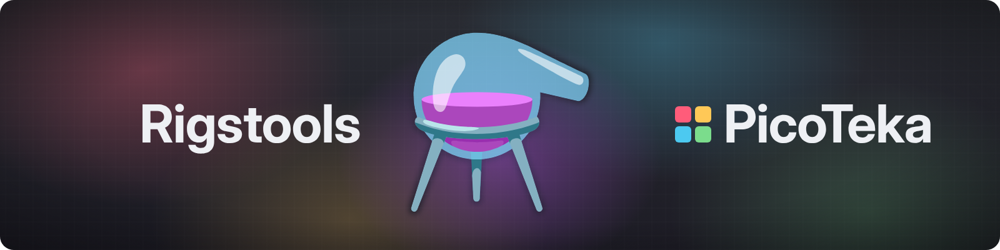
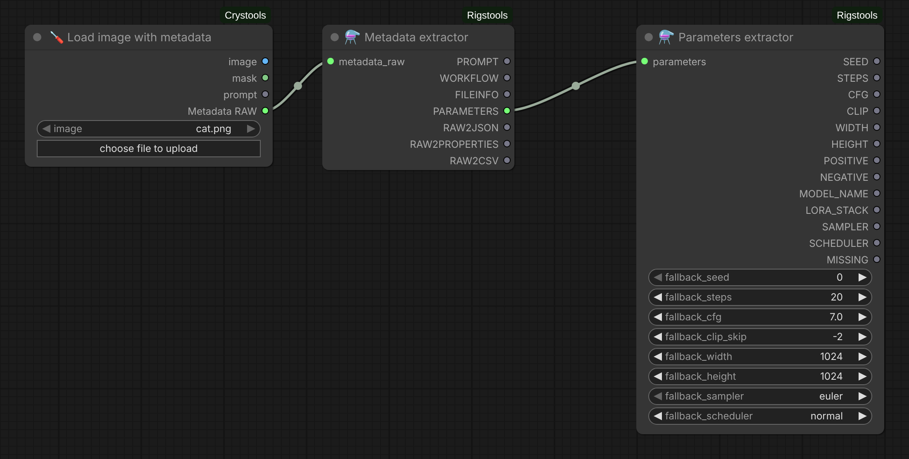
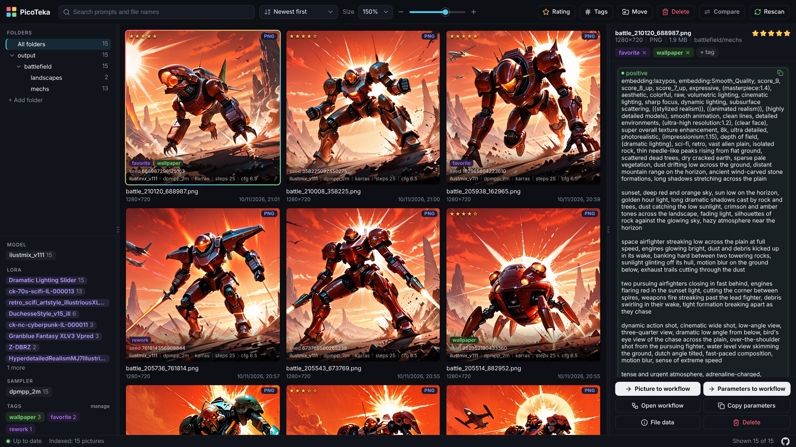
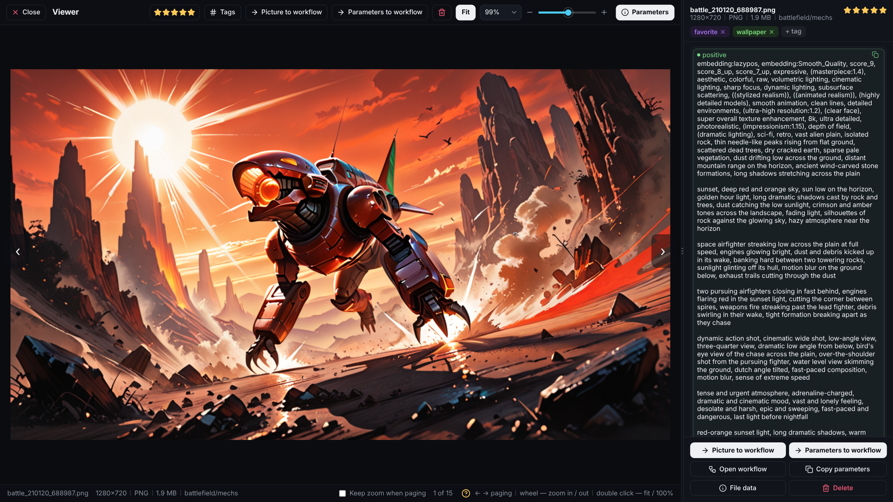
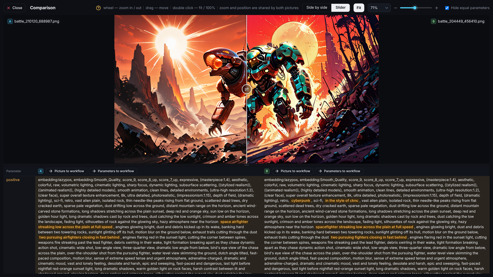
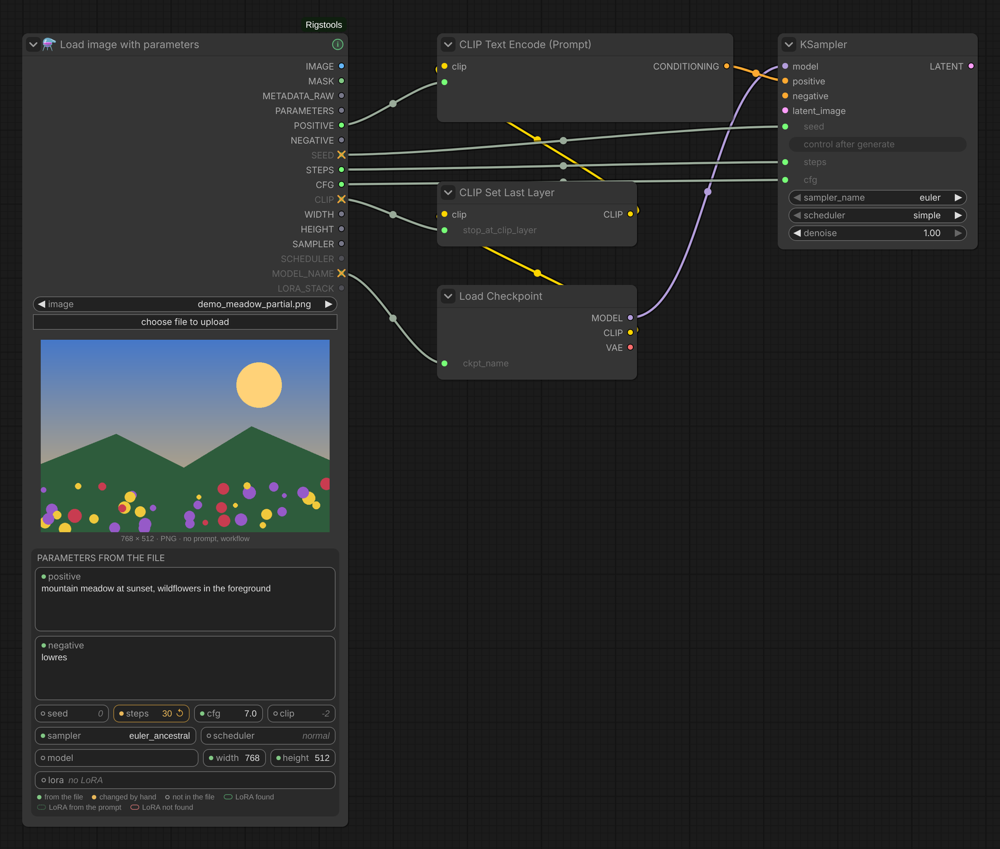
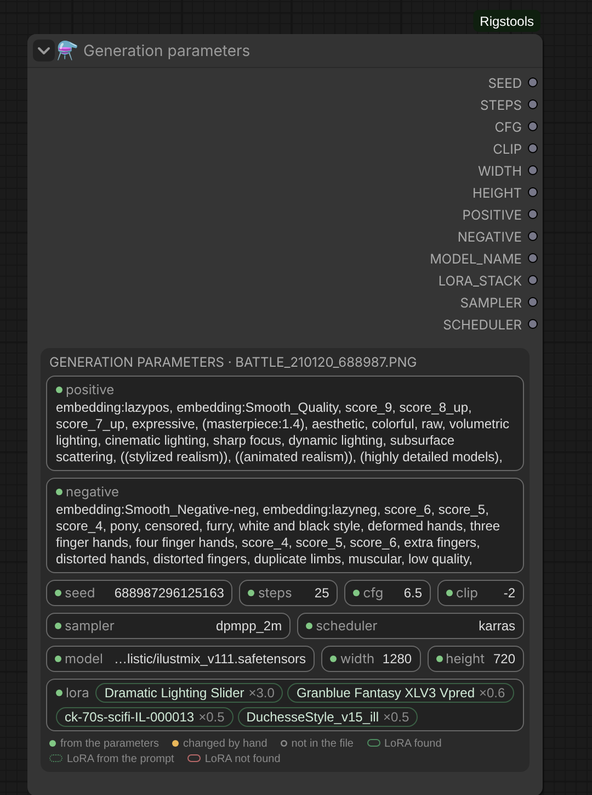
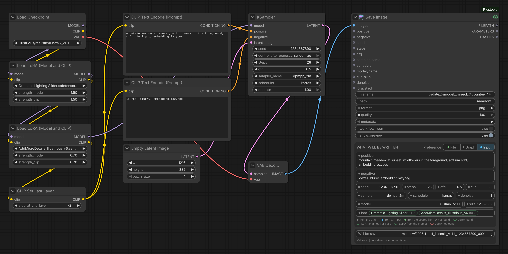
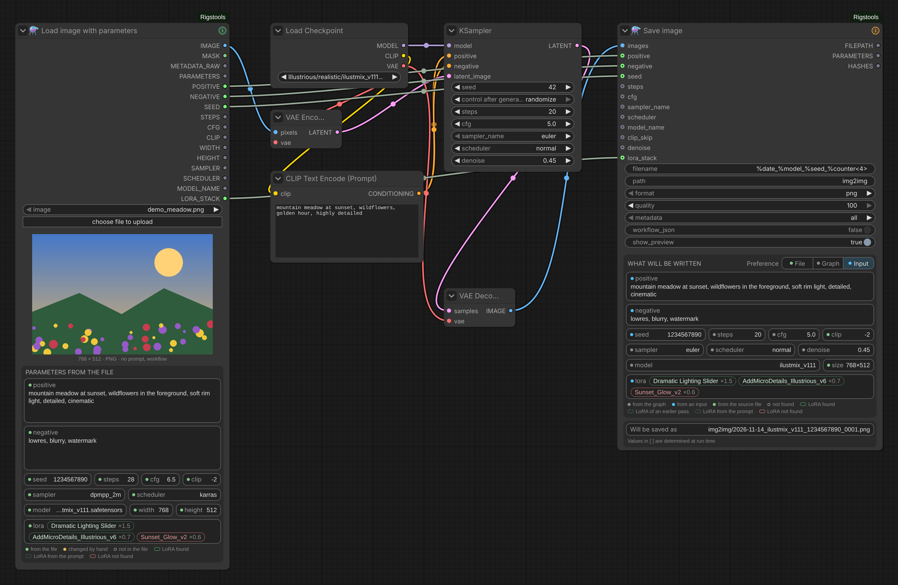
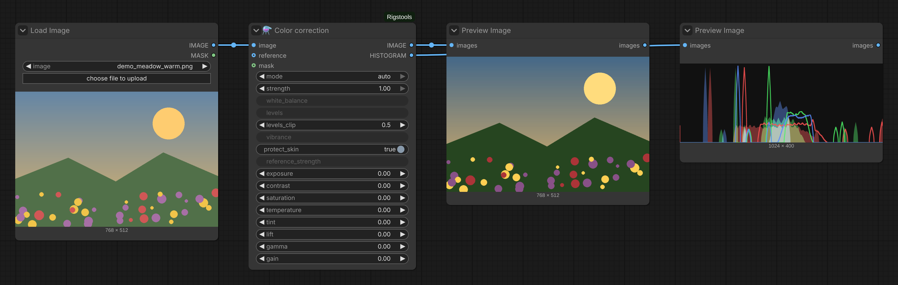

  

  
  

<a href="README.md">English</a> · <b>Русский</b> · <a href="CHANGELOG.ru.md">История изменений</a>

Rigstools начинался как мой собственный набор инструментов для ежедневной работы в ComfyUI. Мне хотелось, чтобы
картинка правильно хранила данные генерации — так, чтобы Civitai узнавал модель, LoRA и параметры, — и чтобы эти данные
можно было взять из готовой картинки прямо в новую генерацию. Со стандартными нодами это превращалось в цепочку
дополнительных нод и проводов, и всё равно получалось не совсем то, с чем хотелось работать. Поэтому каждая нода
Rigstools делает всю работу в одном месте: показывает параметры, позволяет их изменить и отдаёт каждый отдельным
выходом.

Ноды выросли из [ComfyUI-Crystools](https://github.com/crystian/ComfyUI-Crystools) Crystian'а, который давно не
обновляется, и ушли далеко вперёд. Галереи, которые я пробовал, медленно работали с большими папками и неточно читали
промпты, модели и параметры, — поэтому в версии 2.0 появилась своя: **PicoTeka**.

## Что внутри
- **PicoTeka** — быстрая и простая галерея ваших картинок: папки, поиск, фильтры, теги, рейтинг, сравнение; отправляет
  картинку или её параметры прямо в открытый workflow, а выбранные картинки — постом на популярный AI-art сайт
  Civitai.
- **Загрузчики** — картинка вместе с данными генерации (PNG, JPEG, WebP; один файл, папка по номеру или самый новый):
  промпт и workflow ComfyUI и параметры в стиле A1111, видны на ноде, редактируются, каждый — отдельным выходом.
- **Экстракторы** — те же данные из любой картинки в графе; **Generation parameters** хранит параметры без картинки.
- **Save image** — сам собирает параметры из графа и записывает их так, чтобы их читали Civitai и A1111, с хешами
  модели и LoRA.
- **Коррекция цвета** — без нейросетей: баланс белого, уровни, насыщенность, подгонка под образец, гистограмма и
  автоматический режим.

## Установка
- **ComfyUI-Manager:** Custom Nodes Manager → найти «Rigstools» → Install.
- **comfy-cli:** `comfy node install comfyui-rigstools`
- **Вручную:** `git clone https://github.com/ScrudgMcDack/ComfyUI-Rigstools` в папку `ComfyUI/custom_nodes/`.

После установки перезапустите ComfyUI. Дополнительные Python-пакеты — `send2trash` (удаление в корзину в
галерее) и `pyoxipng` (сжатие больших PNG без потерь перед отправкой на Civitai); ComfyUI-Manager и comfy-cli ставят их сами, при ручной установке выполните `pip install -r requirements.txt`.

## PicoTeka — галерея
PicoTeka — быстрая и простая галерея для организации ваших генераций. Открывается своей кнопкой (четыре цветных
квадрата) на верхней панели ComfyUI или по адресу `http://<адрес ComfyUI>/rigstools/gallery` — в отдельной вкладке
браузера, так что ComfyUI продолжает работать.

### Папки и индекс
- Папка output ComfyUI подключена сразу; **+ Добавить папку** добавляет любую другую — её выбирают в обзоре папок
  (только с этого компьютера). Подпапки показываются деревом, Ctrl + щелчок показывает сразу несколько папок.
- Картинки индексируются в фоне. После каждой завершённой генерации галерея сразу проверяет папки — куда бы ни
  сохранилась картинка, — а открытая страница ещё и сама просматривает их раз в 10 секунд, чтобы найти картинки,
  добавленные не через ComfyUI (интервал — в настройках).

### Сетка
- Новые картинки встают на свои места по сортировке сами и ненадолго подсвечиваются. Сетка при этом не прыгает:
  то, на что вы смотрите, остаётся на месте. Если новая картинка сдвинула бы ряды у вас перед глазами, она ждёт
  (кроме самого верха сетки, когда ничего не выбрано), а над сеткой появляется полоса **Новых картинок: N ↑**;
  щелчок по ней показывает их. Стрелка ↓ — новые картинки ниже, например при сортировке «Сначала старые».
- Поиск по промпту и имени файла; фильтры по модели, LoRA, сэмплеру, тегу, рейтингу и дате; сортировка по дате,
  имени и рейтингу. На миниатюрах — формат, рейтинг и теги; чем крупнее миниатюры, тем больше на них видно.
- Щелчок выбирает картинку, Ctrl + щелчок добавляет её к выделению или убирает из него, Shift + щелчок выделяет
  подряд. `Esc` или щелчок по пустому месту снимает выбор.

### Карточка
Выбранная картинка со всеми параметрами — в том же виде, что под нашими загрузчиками, — и кнопки: **Картинку в
workflow**, **Параметры в workflow**, **Открыть workflow**, **Копировать параметры**, **Данные файла** (метаданные как
есть) и **На Civitai** (ниже). Удаление — на верхней панели, в просмотре и по клавише `Delete`.

### Просмотр
Двойной щелчок открывает картинку на весь экран: масштаб (колесо, 100%, вписать), миникарта и панель параметров;
← → листают картинки. Подсказки по мыши и клавишам — за значком **?** на нижней панели.

### Теги, рейтинг, удаление и перемещение
- Теги ставятся и снимаются в выпадающем списке с поиском: он открывается плашкой **+ тег** в карточке, кнопкой
  **Теги** в просмотре и на верхней панели и клавишей T. Можно выбрать несколько тегов сразу; «–» значит, что тег
  стоит только на части выделенных картинок (счётчик — «k из n»). Новый тег может быть создан прямо из поиска.
- Теги ставятся и снимаются в выпадающем списке с поиском: он открывается плашкой **+ тег** в карточке, кнопкой
  **Теги** в просмотре и на верхней панели и клавишей T. Можно выбрать несколько тегов сразу; «–» значит, что тег
  стоит только на части выделенных картинок (счётчик — «k из n»). Новый тег может быть создан прямо из поиска.
- Цвет тега выбирается автоматически; переименовать, слить или удалить теги — **Теги → управлять**. Рейтинг — от 0
  до 5 звёзд. И то и другое работает сразу для нескольких выбранных картинок.
- Удаление отправляет файлы в корзину системы (через пакет `send2trash`, он ставится вместе с нодой); теги и рейтинг
  хранятся 30 дней, так что файл, восстановленный из корзины, возвращается с ними. Shift + Delete (или Shift + щелчок
  по кнопке «Удалить») удаляет файлы безвозвратно, минуя корзину, — после предупреждения. Перемещение кладёт файлы в другую папку галереи или в новую подпапку.
- Файл, перемещённый или переименованный не через галерею, считается новой картинкой.

### Сравнение
Выберите две картинки (Ctrl + щелчок) и нажмите **Сравнить**: рядом или со шторкой. Масштаб (колесо, 5–1600%,
вписать; двойной щелчок — вписать / 100%) и положение (перетаскиванием) общие для обеих; над картинками — их имена
с метками **A** и **B**. Под картинками — таблица: каждый параметр отдельной строкой
с подсветкой различий (промпты — по фразам, LoRA — по имени и весу); **Скрыть одинаковые параметры** оставляет только
различия. Границу между картинками и таблицей можно двигать.

### В открытый workflow
Как в LoRA Manager: галерея отправляет во вкладку ComfyUI, с которой вы работали последней.
- **Картинку в workflow** ставит картинку в *Load image with parameters* или *Load image with metadata*. Картинки из
  папки output берутся как есть, из других папок — копируются в `input/rigstools_gallery/`.
- **Параметры в workflow** заполняет ноду *Generation parameters* (ниже). Новая отправка заменяет все значения, в том
  числе изменённые вручную.
- **Открыть workflow** открывает workflow, сохранённый в картинке, в новой вкладке.

Если подходящих нод в workflow несколько, появляется список с названиями их групп (при наведении на строку нода
показывается на холсте); если нет ни одной — галерея предлагает её добавить.

### На Civitai
**На Civitai** (в карточке, в просмотре и на верхней панели — для выделенных картинок) делает один пост на Civitai из
выбранных картинок в том порядке, в каком их выделяли. За один раз — в одном посте — можно отправить максимум 20
картинок, с заголовком и описанием.
- В форме поддерживается сортировка картинок перетаскиванием, удаление (✕); первая по порядку картинка становится
  обложкой поста. На каждой миниатюре написан формат, в котором картинка будет отправлена на сайт (см. ниже). Жёлтый
  **!** отмечает картинку без параметров генерации (Civitai не найдёт её модель, LoRA, эмбеддинг), красный **10+**
  отмечает картинку, которая не влезет в 10 МБ даже после сжатия.
- Картинки загружаются по очереди; на миниатюре виден статус обработки: жёлтая «крутилка» — идёт загрузка, зелёная
  «галка» — загрузка прошла успешно, красный крест — ошибка загрузки. Строка состояния внизу окна показывает текущий
  шаг, а в конце — ссылку на пост. Отменить загрузку нельзя (Civitai не умеет удалять загруженную картинку, которая
  ещё не в посте). Если закрыть окно, оно прячется в полосу прогресса на нижней панели — щелчок возвращает его, а
  когда пост создан, окно возвращается само и требует дальнейших ваших действий.
- Отправленная картинка получает плашку **CIVITAI** рядом с форматом — на миниатюре и в карточке: серую, пока её пост
  в черновиках, голубую, когда пост опубликован, и красную, если у поста рейтинг R, X или XXX (такие посты Civitai
  показывает на civitai.red, и ссылки на них ведут туда же). Щелчок по плашке показывает посты, в которых картинка
  была добавлена и/или опубликована (номер со ссылкой, состояние, дата). Из формы просмотра постов можно удалить с
  Civitai как эту конкретную картинку, так и сразу весь пост со всеми его изображениями (ваши файлы на диске
  остаются); вместе с последней картинкой поста удаляется и пост. Удалять можно, когда Civitai закончит проверку
  картинок. Пост или картинка, удалённые на сайте Civitai, забываются, когда PicoTeka в следующий раз о них спросит, и
  плашка снимается. Это не тег, вручную её не снять.
- Когда Civitai проверит картинку, рядом с плашкой появляется возрастной рейтинг (PG, PG-13, R, X, XXX); подсказка
  объясняет, что он значит. PicoTeka спрашивает Civitai, когда вы выбираете картинку с плашкой (не чаще раза в 5 минут
  на пост) и когда щёлкаете по плашке; заодно обновляется и состояние поста (черновик / опубликован).
- **Tools** и **Techniques** картинок, как на сайте Civitai: для начала ComfyUI и workflow, txt2img, img2img;
  поменяйте их в окне (добавить можно любой инструмент из списка Civitai) — окно запомнит выбор для следующих постов.
  Они ставятся всем картинкам поста сразу после его создания, и черновику тоже — только то, чего у картинки ещё нет.
- **Опубликовать пост сразу** по умолчанию выключено: пост создаётся черновиком — проверьте его и опубликуйте на
  Civitai самостоятельно, если требуется. Положение обеих галочек запоминается.
- **Оставить данные workflow в файле** по умолчанию включено. Когда выключено — из отправляемой копии убираются
  workflow и промпт ComfyUI, параметры генерации остаются. Файлы на диске не меняются никогда.
- Модель к посту привязывать не требуется: модель, LoRA и параметры Civitai находит в данных картинок сам (их пишет
  нода Save image), так что в одном посте могут быть картинки разных моделей.
- MCP Civitai принимает картинки до 10 МБ. Для PNG больше этого объема PicoTeka пробует по очереди несколько
  вариантов, пока не получит нужное:
  1. **PNG → PNG**: тот же PNG, сжатый сильнее, но без потерь (oxipng, ставится вместе с нодой) — все метаданные
     сохраняются;
  2. **PNG → WEBP**: WebP без потерь — сжатие сильнее, картинка та же пиксель в пиксель; параметры и workflow ComfyUI
     уходят в EXIF (workflow — туда, куда его кладёт сам ComfyUI в WebP);
  3. **PNG → JPEG**: качество 95 — сжатие самое сильное, но с потерями; параметры остаются в EXIF, workflow — нет.

  Большие картинки сжимаются по очереди сразу при открытии формы. У сжатой картинки перед форматом две стрелки внутрь.
  Без «Оставить данные workflow в файле» из копии сначала вырезаются workflow и prompt ComfyUI (сама картинка не
  трогается) — часто этого достаточно. Файл на диске не меняется никогда.
- Новые картинки проходят модерацию Civitai для присвоения им рейтинга и цензурирования, поэтому другие могут увидеть
  ваш пост чуть позже.
- По умолчанию функция отправки картинок выключена. Включите в **Настройки → Rigstools → Civitai → Разрешить
  публикацию из PicoTeka на Civitai** (ниже). Для этого вам потребуется API-ключ Civitai; из соображений безопасности
  работает только с этого компьютера. Картинки уходят через MCP-сервер Civitai (`mcp.civitai.com`), отправляет их
  сервер ComfyUI; ключ хранится у сервера ComfyUI, а не в его настройках, и на страницу не попадает.

### Клавиши
| Где | Клавиши |
|---|---|
| Сетка | стрелки, `Home`, `End` — по сетке · `Enter` — просмотр · `Esc` — снять выбор |
| Выбранные картинки | `0`–`5` — рейтинг · `T` — теги · `M` — переместить · `Delete` — удалить в корзину · `Shift` + `Delete` — удалить безвозвратно (с подтверждением) · `C` — сравнить |
| Просмотр | ← → — листать · `I` — панель параметров · `+` / `−` — масштаб · `Ctrl` + `0` — вписать · `Esc` — закрыть |
| Сравнение | `+` / `−` — масштаб · `Ctrl` + `0` — вписать · `Esc` — закрыть |

Индекс и кэш миниатюр хранятся в `<папка пользователя ComfyUI>/rigstools/gallery`; сами картинки индекс не меняет.

## Ноды

### Load image with metadata
Загружает картинку вместе с данными генерации — замена *Load image with metadata* из Crystools: у `METADATA_RAW`
тот же формат, поэтому Metadata extractor и всё, что после него, работает без изменений.

- **Все форматы, которые пишет Image Saver.** PNG — текстовые чанки; JPEG и WebP — EXIF: `UserComment` → parameters
  (Image Saver, A1111, Forge), `Make` / `Model` → workflow / prompt (Image Saver, стандартный *Save Animated WEBP*,
  старый Crystools). Crystools полностью читает только PNG.
  В JPEG помещается не больше 64 КБ EXIF, поэтому Image Saver обычно сохраняет туда только параметры.
- **Папка input или output.** В списке сначала файлы input, затем файлы output (новые сверху, с пометкой
  `[output]`) — свои результаты можно загружать без копирования в input. Кнопка загрузки кладёт файл в input.
- **Что есть в файле — видно сразу:**
  - подпись под картинкой продолжает стандартную: `1024 × 1536 · PNG · все метаданные ✓`, иначе в ней сказано,
    чего не хватает (`parameters из prompt`, `нет prompt, workflow`, `нет метаданных`);
  - выходы, по которым ничего не придёт, приглушены; `PARAMETERS ↻` с оранжевой точкой — восстановлено из промпта ComfyUI;
    у **подключённого** выхода, по которому ничего не придёт, вместо точки оранжевый ✕, а в подсказке — причина
    (кроме `LORA_STACK`: «нет LoRA» — нормальный ответ);
  - кнопка **ⓘ** в заголовке (зелёная / оранжевая / серая) открывает полный текст параметров с кнопками
    «Копировать parameters», «Копировать prompt (JSON)» и «Открыть workflow» (в новой вкладке, как при перетаскивании файла на холст).
- Маска из альфа-канала (маски из редактора масок сохраняются), поворот по EXIF, файл перечитывается при изменении.

| Выход | Тип | Что внутри |
|---|---|---|
| `IMAGE`, `MASK` | IMAGE, MASK | картинка и маска из её альфа-канала |
| `METADATA_RAW` | METADATA_RAW | все метаданные — подключается к **Metadata extractor** |
| `PARAMETERS` | STRING | параметры A1111 (восстановленные из промпта, если в файле их нет) — можно сразу в **Parameters extractor** |
| `FILENAME` | STRING | имя файла с расширением |

### Load image with parameters
Тот же загрузчик, но параметры генерации показаны прямо под картинкой, каждый в своём поле, — и каждый идёт на свой
выход. Одна нода вместо цепочки *Load image with metadata → Metadata extractor → Parameters extractor*; отдельные ноды
остаются, поэтому старые workflow работают, а ноды можно сочетать как угодно (`METADATA_RAW` → Metadata extractor,
`PARAMETERS` → Parameters extractor, `LORA_STACK` → LoRA hashes for Image Saver).

*В картинке нет seed, clip skip и модели: у их полей пустой кружок, а на подключённых выходах `SEED`, `CLIP` и
`MODEL_NAME` — ✕, на них идёт подстановка. `steps` введено вручную: оранжевое, ↺ возвращает значение из файла.*

- Поля, в карточке «Параметры из файла»: позитивный и негативный промпт, `seed · steps · cfg · clip`,
  `sampler · scheduler`, `model · width · height`, LoRA. Точка перед названием показывает, откуда значение:
  зелёная — из файла, янтарная — изменено вручную, пустой кружок — нет в файле; пояснение — под полями.
  Save image показывает свои значения в такой же карточке.
  Они растягиваются вместе с нодой; на узкой ноде сначала сокращаются названия (`sched…`), полное значение — в подсказке.
  Промпты и длинный список LoRA прокручиваются колёсиком мыши; когда прокручивать дальше некуда, колёсико масштабирует холст, как обычно.
- **LoRA** — сами модели, а не текст тегов: каждая LoRA картинки с весом, найденная в `models/loras` (с подпапкой);
  красная — не найдена. При наведении видно файл. Если в имени из картинки нет эпохи, а у файла есть
  (`Style` → `Style-000003.safetensors`), берётся этот файл — когда такая эпоха одна.
- **Поля можно править.** Изменённое значение подсвечивается и идёт на выход вместо значения из картинки; ↺ возвращает
  значение из картинки, Esc отменяет ввод. Введённые значения относятся к картинке — при выборе другой картинки они
  сбрасываются. Сохраняются вместе с workflow.
- Значения, которых нет в картинке, берутся по умолчанию (серым курсивом: seed 0, steps 20, cfg 7, clip −2,
  1024 × 1024, euler / normal), их выходы приглушены. Модель, не найденная
  в `models/checkpoints`, — красная.
- Подпись, приглушённые выходы и кнопка ⓘ — как у Load image with metadata.

Выходы: `IMAGE`, `MASK`, `METADATA_RAW`, `PARAMETERS`, `POSITIVE`, `NEGATIVE`, `SEED`, `STEPS`, `CFG`, `CLIP`, `WIDTH`,
`HEIGHT`, `SAMPLER`, `SCHEDULER`, `MODEL_NAME`, `LORA_STACK`. `PARAMETERS` — текст из файла;
значения, введённые в панели, в него не записываются.

### Load image from folder
Те же выходы плюс `INDEX` и `COUNT`, но файл выбирается из папки:

- `folder`: `output`, `output/STEP_1`, `input/…`, `temp` или абсолютный путь (просто относительный путь — внутри output);
- `mode`: **by index** — файл номер `index` в отсортированном списке; с *control after generate* = `increment`
  каждый запуск берёт следующий файл и после последнего начинает сначала, так что очередь из N запусков
  обработает всю папку; **latest** — самый новый файл (сгенерировал → сразу доработал);
- `pattern`: фильтр имён, несколько через `;` (`STEP_1_*.png; *.webp`), `sort`: по имени (естественный порядок,
  2 раньше 10) или по дате изменения, `subfolders` — с подпапками.

После запуска нода показывает картинку с той же подписью, приглушёнными выходами и кнопкой ⓘ (в окне — номер файла в списке).
В режиме *latest* не сохраняйте в ту же папку из того же workflow — иначе следующий запуск возьмёт собственный результат.

### Metadata extractor
Раскладывает метаданные картинки по отдельным выходам.

| Выход | Тип | Что внутри |
|---|---|---|
| `PROMPT` | JSON | промпт ComfyUI (API-формат), сохранённый в картинке |
| `WORKFLOW` | JSON | workflow ComfyUI, сохранённый в картинке |
| `FILEINFO` | JSON | имя файла, разрешение, дата, размер |
| `PARAMETERS` | STRING | текст параметров в формате A1111 — подключается к **Parameters extractor** |
| `RAW2JSON` | JSON | все метаданные в JSON |
| `RAW2PROPERTIES` | STRING | все метаданные строками `ключ=значение` |
| `RAW2CSV` | STRING | все метаданные строками «ключ — значение» через табуляцию |

**Картинки без parameters** (например, сохранённые стандартным *Save Image*): при включённом `parameters_from_prompt`
(по умолчанию) параметры восстанавливаются из промпта ComfyUI, сохранённого в картинке. В графе находится главный
сэмплер (txt2img-сэмплер с пустым латентом важнее детейлеров и апскейлеров), и по связям восстанавливаются seed, steps,
CFG, сэмплер, планировщик, размер, промпты, чекпойнт, LoRA (LoraLoader, LoRA Manager) и clip skip — в том числе через
переключатели, склейку строк и ноды Show Text. Значения, которые нельзя определить надёжно (случайный seed, wildcards,
раскрываемые при запуске, неизвестные ноды), пропускаются — для них Parameters extractor возьмёт запасные.
Восстановленный текст заканчивается на `Version: ComfyUI (rebuilt from prompt)`.

Вход: `metadata_raw` (`METADATA_RAW`) из **Load image with metadata** — Rigstools или
[ComfyUI-Crystools](https://github.com/crystian/ComfyUI-Crystools).

### Parameters extractor
Разбирает текст параметров A1111 на отдельные значения.

| Выход | Тип | Что внутри |
|---|---|---|
| `SEED` | INT | seed |
| `STEPS` | INT | число шагов |
| `CFG` | FLOAT | CFG scale |
| `CLIP` | INT | clip skip отрицательным числом (например, `-2`) — сразу для *CLIP Set Last Layer* |
| `WIDTH`, `HEIGHT` | INT | размер картинки |
| `POSITIVE`, `NEGATIVE` | STRING | промпты ровно в том виде, как записаны в картинке (с тегами LoRA — они тоже часть текста, который видел энкодер) |
| `MODEL_NAME` | STRING | путь к чекпойнту в `models/checkpoints`, если файл найден (с подпапками, без учёта регистра), иначе имя из картинки |
| `LORA_STACK` | STRING | теги `<lora:имя:вес>`: поле `Lora stack`, а если его нет — теги LoRA из позитивного промпта; `None`, если LoRA в картинке нет |
| `SAMPLER`, `SCHEDULER` | combo | имена ComfyUI, переведённые из имён A1111 / Civitai (`DPM++ 2M Karras` → `dpmpp_2m` + `karras`) |

Вход: `parameters` — выход `PARAMETERS` ноды Metadata extractor.

**Запасные значения.** `fallback_seed`, `fallback_steps`, `fallback_cfg`, `fallback_clip_skip`, `fallback_width`,
`fallback_height`, `fallback_sampler`, `fallback_scheduler`: если значение есть в картинке, берётся оно, иначе — запасное.
Их можно задать прямо на ноде или превратить во входы и подключить свои значения. Картинки без параметров
(например, сохранённые стандартным Save Image) больше не останавливают workflow — все значения берутся из запасных.

### Generation parameters
Хранит параметры генерации без картинки — галерея заполняет её кнопкой **Параметры в workflow**. Панель та же, что под
*Load image with parameters*: любое значение можно изменить вручную (его отмечает янтарная точка), а выходы — те же,
что у Parameters extractor: `SEED`, `STEPS`, `CFG`, `CLIP`, `WIDTH`, `HEIGHT`, `POSITIVE`, `NEGATIVE`, `MODEL_NAME`,
`LORA_STACK`, `SAMPLER`, `SCHEDULER`. Значения сохраняются вместе с workflow.

### LoRA hashes for Image Saver
Превращает стек LoRA (`<lora:имя:вес> …`) в строку для входа `additional_hashes` ноды
[Image Saver](https://github.com/alexopus/ComfyUI-Image-Saver). LoRA попадают в метаданные картинки и связываются с Civitai
**без тегов LoRA в промпте** — теги меняют текст, который видит энкодер, а значит и результат.

| Вход / выход | Что это |
|---|---|
| `lora_stack` | теги LoRA, например выход `LORA_STACK` ноды Parameters extractor |
| `with_weights` | писать `Имя:ХЭШ:вес`; Image Saver принимает веса, только если у него включён `download_civitai_data`, иначе выключите |
| `additional_hashes` (необязательный) | хэши, которые нужно сохранить; ставятся перед хэшами LoRA |
| `ADDITIONAL_HASHES` | подключается ко входу `additional_hashes` ноды Image Saver |
| `NOT_FOUND` | LoRA из стека, которых нет в `models/loras` |

Каждая LoRA ищется в `models/loras` (так же, как это делает Image Saver) и хэшируется SHA-256 (первые 10 символов).
Хэш кэшируется в файле `<lora>.sha256` рядом с LoRA — это тот же кэш, что у Image Saver, поэтому файл считается один раз.

> Стандартная нода ComfyUI **Save Image** не записывает параметры в формате A1111 в PNG.
> Чтобы они были, сохраняйте картинки A1111-совместимым сохранителем (например, нодами *Image Saver*).

### Save image
Сохраняет картинки с данными генерации **без ручного подключения параметров**: нода идёт по графу назад от картинки
и находит сэмплер, промпты, seed, steps, CFG, сэмплер и планировщик, чекпойнт, LoRA из нод-загрузчиков (LoraLoader,
Power Lora Loader, LoRA Manager), clip skip и проходы апскейла и детейлеров. Значения, которые наши загрузчики читают из
файла (Parameters extractor, Load image with parameters), берутся из этого файла.

*txt2img: все значения найдены в графе — LoRA из двух загрузчиков, clip skip из CLIP Set Last Layer, размер из пустого
латента.*

Панель на ноде показывает, что **запишет следующий запуск**, в тех же полях, что у Load image with parameters:
каждое значение с точкой — серой (из графа), синей (из подключённого входа), зелёной (из исходного файла) или пустым
кружком (не найдено), — и имя следующего файла. В этом имени значения, которые определяются только при выполнении, —
время, размер после апскейла, значение подключённого входа, которое вычисляет другая нода, — показаны в скобках:
`[time]`, `[width]`, `[height]`, `[seed]`. Нода и окно ⓘ всегда показывают следующее сохранение, был запуск или нет;
что записано фактически, видно в консоли (Настройки → Rigstools → Debug). ⓘ в заголовке открывает блоки, которые
пишутся в файл, предупреждения и замечания (LoRA нет в `models/loras`, хэш будет посчитан, у ресурса нет ID Civitai)
и полный текст параметров. Нода увеличивается, если данные не помещаются, и сама не сжимается — заданная вручную
высота сохраняется. **🛟 Справка по ноде** в контекстном меню ноды — переменные имени файла, коды даты и примеры.

#### Какой проход даёт значения
Нода упорядочивает сэмплеры выше картинки в порядке выполнения и берёт только проходы, которые перерисовывают всю
картинку, — сэмплеры и апскейлеры (Ultimate SD Upscale и подобные). Детейлеры и инпейнт-сэмплеры (латент или
кондиционирование сэмплера идут через ноду инпейнта / *Set Latent Noise Mask*) перерисовывают только часть и не
используются.
- **txt2img** — проход начинается с пустого латента: основные значения берутся из первого такого прохода, поля Hires
  (`Hires upscale`, `Hires steps`, `Hires upscaler`, denoise) — из последнего целого прохода после него; апскейлер —
  модель апскейла, ближайшая перед этим проходом.
- **img2img** — ни один проход не начинается с пустого латента: основные значения берутся из последнего целого прохода,
  он и сделал картинку; полей Hires нет.

txt2img или img2img определяется по типу ноды латента, а не по его размеру.

#### Промпты и другие значения
- Промпт прослеживается от текстового энкодера основного прохода назад через ноды, пропускающие кондиционирование,
  переключатели, пайпы, Show Text и склейки строк.
- **При запуске** нода берёт из кэша выполнения ComfyUI значения, которые ноды действительно выдали в этом запуске, —
  например, текст склейки вместе с trigger words, которые добавляет LoRA Manager. В логе консоли такое значение
  помечено `[runtime]`. Кэш — внутренний механизм ComfyUI; если значения в нём нет, работают правила ниже.
- **До запуска** (и как запасной вариант): склейка оставляет известные части и пропускает те, что известны только
  при выполнении; если не известна ни одна часть, в img2img берётся промпт исходной картинки.
- **Размер:** из пустого латента; в img2img, если граф его не даёт, при запуске пишется размер сохраняемой картинки
  (кроме случая с полями Hires). До запуска он показан как не найденный.
- Значение из исходного файла помечается «из файла», только если доходит до ноды без изменений; если в графе к нему
  приклеен текст, оно «из графа».

#### Приоритет: какой источник главный
Переключатель **Приоритет: Файл | Граф | Вход** в шапке карточки выбирает главный источник для всех полей, остальные —
запасные:

| Приоритет | Порядок |
|---|---|
| Вход (по умолчанию) | подключённый вход → граф → исходный файл |
| Граф | граф → подключённый вход → исходный файл |
| Файл | данные генерации исходной картинки → подключённый вход → граф |

Подключённый вход учитывается, даже если его значение известно только при выполнении. Размер из исходного файла не
берётся никогда (у увеличенной картинки он другой). Выбор сохраняется в workflow; у workflow, сохранённых раньше, —
*Вход*, то есть прежнее поведение.

*img2img: `positive`, `negative`, `seed` и `lora_stack` подключены от загрузчика (синие точки), steps, CFG, сэмплер и
denoise берутся из KSampler этого прохода. Красной LoRA нет в `models/loras`, поэтому ⓘ в заголовке оранжевый.*

#### LoRA
- **Вход:** подключённый `lora_stack` заменяет весь список. Он принимает текст из тегов `<lora:имя:вес>` через пробел —
  так его отдаёт выход `LORA_STACK` наших загрузчиков; это не тип `LORA_STACK` нод-стекеров.
- **Граф:** загрузчики на пути модели основного прохода (LoraLoader, LoraLoaderModelOnly, Power Lora Loader,
  LoRA Manager — его активные строки, в любом из двух видов, в которых приходит его список), а перед ними LoRA
  предыдущих проходов: теги `<lora:…>` в промпте исходной картинки, её `Lora stack`, затем теги в текущем промпте.
  У LoRA, встреченной дважды, остаётся запись этого прохода. Чипы на ноде показывают, откуда каждая: сплошная рамка —
  этот проход, пунктир — предыдущий проход, точки — тег в промпте; красная — не найдена в `models/loras`.
- **Файл:** только LoRA исходной картинки.

Все они попадают в `Lora hashes`, `Civitai resources` и `Lora stack`.

| Вход / выход | Что это |
|---|---|
| `filename`, `path` | имя файла и подпапка в папке output; переменные `%date`, `%date<%Y%m%d>`, `%time`, `%model`, `%seed`, `%steps`, `%cfg`, `%sampler`, `%scheduler`, `%width`, `%height`, `%counter`, `%counter<4>` (следующий свободный номер). Существующий файл никогда не перезаписывается |
| `format`, `quality` | png, jpeg (метаданные до 64 КБ), webp (без потерь при quality 100); quality по умолчанию 100 |
| `metadata` | all — параметры + workflow; parameters only — для публикации без своего workflow; none — ничего |
| `workflow_json` | дополнительно сохранять workflow рядом с картинкой как `<имя>.json` |
| `positive`, `negative`, `seed`, `steps`, `cfg`, `sampler_name`, `scheduler`, `model_name`, `clip_skip`, `denoise`, `lora_stack` (необязательные) | подключите, чтобы задать значение самим — например, промпт, который нода wildcards собирает во время запуска и которого нет в графе; при приоритете «Вход» (по умолчанию) он главнее графа. `lora_stack`: теги `<lora:имя:вес>` через пробел |
| `FILEPATH` | полные пути сохранённых файлов |
| `PARAMETERS` | записанный текст параметров A1111 |
| `HASHES` | хэши модели, LoRA и embeddings |

В тексте параметров — поля A1111, которые читают A1111, Forge и Civitai, в том числе `Schedule type`, `Denoising strength`,
`Hires upscale` / `Hires steps` / `Hires upscaler`, `Lora hashes`, `TI hashes`, `Hashes`, а также `Lora stack`, чтобы наши
загрузчики возвращали LoRA с весами. Хэши берутся из кэша `<файл>.sha256` рядом с моделью (тот же, что у Image Saver);
кэш старше файла пересчитывается.

**Civitai resources.** Веса LoRA Civitai берёт только из блока `Civitai resources`, где каждая модель указана своим ID
версии на Civitai. Нода пишет его для всех моделей, LoRA и embeddings, ID которых знает. Такие модели попадают только
в этот блок (как у Image Saver), остальные Civitai находит по хэшам; LoRA без ID тоже свяжется с Civitai, только без веса.

Откуда берутся данные:

| Что | Источник |
|---|---|
| хэши (SHA-256, в файл идут первые 10 символов) | `<модель>.sha256` рядом с моделью — тот же кэш, что у Image Saver; или SHA-256 из `.metadata.json` от LoRA Manager; иначе нода один раз хэширует файл сама |
| ID версий Civitai, по порядку | 1. наш кэш `<папка пользователя ComfyUI>/rigstools/civitai.json` (по полному SHA-256 — переименование и перенос модели ему не мешают); 2. файлы рядом с моделью: `<модель>.metadata.json` от LoRA Manager, `<модель>.civitai.info` от Image Saver / Civitai Helper; 3. только если включено **Настройки → Rigstools → Civitai → Искать модели на Civitai по хэшу** (по умолчанию выключено): открытый API Civitai по хэшу, без ключа API |

Найденное в пунктах 2 и 3 сохраняется в наш кэш, поэтому дальше работает и без LoRA Manager и Image Saver. Ответ «нет
на Civitai» запоминается и перепроверяется через неделю. Файлы LoRA Manager находятся, только если он хранит их рядом с
моделями (так у него по умолчанию); при его централизованном хранении они не видны — тогда включите поиск по хэшу.
Поиск отправляет на civitai.com хэши ваших файлов, то есть Civitai узнаёт, какими моделями вы пользуетесь. В папки
моделей нода ничего не пишет. Если большой workflow не влезает в JPEG, нода предупреждает; чтобы сохранить его
файлом, включите `workflow_json`.

### Color correction
Автоматическая цветокоррекция без нейросетей — замена режима Auto у других нод цвета, где каждый шаг виден и
настраивается. Каждая картинка пакета измеряется отдельно.

| Вход / выход | Что это |
|---|---|
| `mode` | `manual` — `white_balance`, `levels` и `vibrance` задаются вручную и одинаковы для всех картинок. `auto` — нода измеряет каждую картинку и выбирает их сама, плюс небольшую поправку экспозиции (см. ниже) |
| `strength` | общая сила: 0 — оригинал, 1 — полная коррекция |
| `white_balance` | убирает цветовой сдвиг: почти нейтральные области приводятся к серому, насыщенные цвета сохраняют оттенок. Задуманное тёплое / холодное настроение — тоже сдвиг, для таких картинок держите значение низким |
| `levels`, `levels_clip` | растягивают яркость между самыми тёмными и самыми светлыми тонами (`levels_clip` — сколько % пикселей отбросить с каждого края); оттенок и насыщенность не меняются |
| `vibrance`, `protect_skin` | поднимают насыщенность блёклых цветов сильнее, чем насыщенных; оттенки кожи защищены |
| `reference` (необязательный), `reference_strength` | подгоняют среднее и разброс яркости и цвета под образец — например, под картинку до апскейла, если апскейл сдвинул цвета |
| `exposure`, `contrast`, `saturation`, `temperature`, `tint`, `lift`, `gamma`, `gain` | ручные поправки после автоматических шагов (0 — выключено) |
| `mask` (необязательный) | исправлять только там, где маска белая |
| `IMAGE` | исправленная картинка (альфа-канал сохраняется) |
| `HISTOGRAM` | гистограммы RGB результата, оригинал — контуром; подключается к Preview Image |

Порядок: образец → баланс белого → уровни → вибранс → ручные поправки → маска → `strength`.

**Режим auto.** Для каждой картинки нода измеряет цветовой сдвиг почти нейтральных областей, точку чёрного, среднюю
яркость и среднюю насыщенность и выбирает:
- баланс белого — убирается только тёплый (желтоватый) сдвиг, и мягко: чем сильнее сдвиг, тем меньше сила, так что он
  смещается примерно на одну единицу Lab; холодный сдвиг остаётся;
- уровни — слабее, если точка чёрного приподнята (дымку не растягивает резко);
- вибранс — больше для блёклых картинок, меньше для уже насыщенных;
- экспозиция — тёмная картинка чуть затемняется (до −0.15 ступени), светлая не меняется.

Правила подобраны по виду режима Auto у Easy Color Corrector. `levels_clip`, `protect_skin`, образец и ручные поправки
работают в обоих режимах. При включённом Debug измеренные значения и выбранные силы выводятся в консоль.

`reference_strength` неактивен, пока образец не подключён, `white_balance`, `levels` и `vibrance` — в режиме auto.
**🛟 Справка по ноде** в контекстном меню ноды описывает
каждую настройку.

### Отметки на выходах
Все ноды Rigstools показывают, что придёт по их выходам:
- **приглушён** — ничего или только подстановка (значение по умолчанию, fallback, пустая строка);
- **↻ с оранжевой точкой** — parameters восстановлены из промпта ComfyUI;
- **оранжевый ✕ вместо точки** — выход подключён, а по нему идёт подстановка (или, у `ADDITIONAL_HASHES`, часть LoRA
  не найдена и их хэшей нет). `LORA_STACK = None` и пустой `ADDITIONAL_HASHES`
  без LoRA крестом не отмечаются — «нет LoRA» — нормальный ответ.

Загрузчики знают это из файла. Metadata extractor, Parameters extractor и LoRA hashes предсказывают это ещё до запуска,
если цепочка начинается с загрузчика Rigstools, иначе показывают после запуска (до переподключения входа).

**Подсказки.** Подсказки выходов говорят, что это за выход и что значит его ✕. С установленным
[Draftsman](https://github.com/ScrudgMcDack/ComfyUI-Draftsman) они относятся к текущей картинке: короткий заголовок и
цветная строка — зелёная: что идёт на выход («Из параметров: 142778012163523»), оранжевая: почему идёт подстановка
(«В параметрах нет seed — на выход идёт fallback_seed = 42»), серая: примечание. Без Draftsman показывается
стандартная подсказка (на английском).

## Настройки
Все настройки — в ComfyUI: **Настройки → Rigstools**.

**PicoTeka**
- **Использовать галерею** — по умолчанию включено. Выключено: нет кнопки галереи и индексации, ноды работают как
  прежде.
- **Автообновление** — как часто открытая галерея ищет картинки, появившиеся не через генерацию ComfyUI: по
  умолчанию 10 с; 30 с, 60 с или выкл — для больших и сетевых папок. После каждой завершённой генерации проверка идёт
  сразу в любом случае.
- **Разрешить удаление и перемещение файлов с других компьютеров** — когда ComfyUI открыт по сети (запуск с
  `--listen`). По умолчанию выключено: удалять и перемещать можно только с этого компьютера.

**Civitai**
- **Искать модели на Civitai по хэшу** — для блока «Civitai resources» в Save image (см. выше). По умолчанию
  выключено.
- **Разрешить публикацию из PicoTeka на Civitai** — по умолчанию выключено. Когда выключено: кнопок «На Civitai» нет,
  и на Civitai ничего не отправляется — даже запросы на проверку API-ключа.
- **API-ключ** — для публикации из PicoTeka. Создайте его на civitai.com: Account settings → API Keys → Add API key,
  вставьте в поле и нажмите Enter: ключ проверяется на Civitai, и значок перед полем показывает: **Ключ принят**
  (зелёный), **Ключ отвергнут** (красный), **Ключ не задан** или **Ключ не проверен** (жёлтый — например, нет связи
  или не разрешена публикация на Civitai); имя аккаунта указывается в подсказке. Поле только принимает ключ: он
  хранится не в настройках ComfyUI (их получает каждая страница, открывшая ComfyUI), а у сервера ComfyUI — в `<папка
  пользователя ComfyUI>/rigstools/civitai_key`, — и никогда не показывается и не отдаётся обратно; кнопка с корзиной
  удаляет его. Задать ключ можно только с этого компьютера. Если вручную задана переменная окружения
  `CIVITAI_API_KEY`, то она имеет приоритет и используется для обмена с Civitai.

**Debug**
- **Писать в консоль подробности работы нод** — в консоль ComfyUI:
  - Save image при каждом сохранении: файлы, проходы в порядке выполнения, откуда взяты Hires-поля, все значения с
    источником, LoRA и предупреждения;
  - Load image with parameters, Parameters extractor и Metadata extractor: что прочитано из файла (с пометками «по
    умолчанию» и «введено вручную»), найдена ли модель;
  - Color correction: что измерили и изменили автоматические шаги (в режиме auto — ещё и выбранные силы).

  Загрузка картинки в панель по шагам пишется в консоль браузера.

**Язык** берётся из настройки ComfyUI **Comfy.Locale**: `ru` — русский, любой другой — английский. Панели, диалоги,
справка, сообщения и (с Draftsman) подсказки выходов переключаются сразу, названия настроек — после перезапуска
ComfyUI. Названия нод, входов и виджетов, их стандартные подсказки и лог в консоли остаются на английском.

**Переменные окружения:** `RIGSTOOLS_LOGLEVEL` — уровень логирования Python (по умолчанию `20` = INFO),
`RIGSTOOLS_INDENT` — отступ JSON на выходах (по умолчанию `2`). Старые имена `CRYSTOOLS_*` тоже работают.

## Ограничения
- **Nodes 2.0** (Vue-ноды), новый вид нод ComfyUI, пока не поддерживается. Панели, превью, отметки на выходах и блок
  Save image рисуются на классическом холсте LiteGraph, поэтому при включённом Nodes 2.0 они не видны или работают
  не так, как задумано. Держите Nodes 2.0 выключенным в настройках ComfyUI. Поддержка запланирована в одной из
  следующих версий.

## Лицензия
MIT — см. [LICENSE](LICENSE). Основано на ComfyUI-Crystools (MIT, © Crystian).
- Иконка и баннер — эмодзи «alembic» из Noto Emoji (Apache 2.0).
- Значок в боковой панели настроек и значки галереи — Lucide (ISC); знак GitHub в галерее — Simple Icons (CC0).

Подробнее — в [THIRD_PARTY_NOTICES.md](THIRD_PARTY_NOTICES.md).
